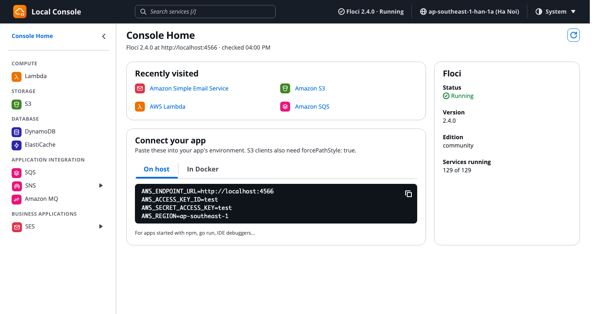

# ☁️ Local Console

**The AWS Console for your local AWS.** Local Console runs next to [Floci](https://github.com/floci-io/floci), a local AWS emulator, and lets you see and change what your app does against it: the emails it sent, the messages waiting in a queue, the items in a table, the logs of the function that just ran. It is built with [Cloudscape](https://cloudscape.design), the design system of the AWS Console, so it looks and works the way you already know.

Your app keeps using the normal AWS SDK. Nothing goes to AWS, nothing costs money, no real credentials needed.

[](https://github.com/floci-io/floci)
[](https://docs.docker.com/get-started/get-docker/)
[](https://cloudscape.design)



## 💡 Why

Floci emulates AWS on your machine, but on its own you only have the AWS CLI to look inside. While coding you want quick answers: _Did the sign-up flow send the email? What is in that queue? Why didn't the S3 upload trigger my function?_ Local Console answers them in a click, and makes the error paths easy to try (failed messages, dead-letter queues, bounced emails), which are hard to test on real AWS.

## ✨ Features

|     | Service                                                  | What you can do                                                                                                                                         |
| --- | -------------------------------------------------------- | ------------------------------------------------------------------------------------------------------------------------------------------------------- |
| 🪣  | [Amazon S3](https://docs.aws.amazon.com/s3/)             | Buckets, folders and objects: upload, preview, download, versions, metadata, pre-signed URLs. Bucket tags, lifecycle, CORS, policy, event notifications |
| λ   | [AWS Lambda](https://docs.aws.amazon.com/lambda/)        | Create functions, edit code in the browser, test with saved events (sync or async), read logs, triggers from S3 / SQS / DynamoDB / SNS (filter patterns, partial batch, retry and on-failure destinations), asynchronous invocation settings with success / failure destinations                 |
| 🗄️  | [Amazon DynamoDB](https://docs.aws.amazon.com/dynamodb/) | Tables and indexes, scan and query with filters, create and edit items as JSON, import / export, TTL, streams                                           |
| 📬  | [Amazon SQS](https://docs.aws.amazon.com/sqs/)           | Standard and FIFO queues, peek without consuming, send and poll messages, dead-letter queues and redrive                                                |
| 📣  | [Amazon SNS](https://docs.aws.amazon.com/sns/)           | Topics, subscriptions (SQS, Lambda, HTTP) with filter policies, publish, inbox of text messages (SMS)                                                   |
| 📅  | [Amazon EventBridge](https://docs.aws.amazon.com/eventbridge/) | Event buses and send events, rules with a pattern tester and targets (Lambda, SQS, SNS), EventBridge Scheduler (one-time, rate, cron) with schedule groups |
| ✉️  | [Amazon SES](https://docs.aws.amazon.com/ses/)           | Mailbox of every email your app sent (HTML preview, text, headers), sender identities with a default configuration set, templates, configuration sets that send events (send, delivery, bounce, complaint) to SNS or the default event bus                                                       |
| ⚡  | [ElastiCache](https://docs.aws.amazon.com/elasticache/)  | Valkey / Redis OSS clusters: endpoints, browse and edit keys                                                                                            |
| 🐇  | [Amazon MQ](https://docs.aws.amazon.com/amazon-mq/)      | RabbitMQ brokers: queues and exchanges, publish and peek messages                                                                                       |
| 🔐  | [Amazon Cognito](https://docs.aws.amazon.com/cognito/)   | User pools: users, groups, app clients, test sign-in with decoded tokens, Lambda triggers, invitation emails through SES, domain and federated sign-in with OIDC / Google through the hosted UI |

Across the console:

- 🔗 **Wired like AWS:** S3 notifications → Lambda / SQS / SNS, queue and stream triggers for Lambda, SNS fan-out. Connected resources link to each other (queues, topics and functions also list the S3 notifications, Lambda destinations and SES sets that send to them), and references to deleted resources are flagged instead of failing silently.
- 🔍 **Search** any service from the top bar (press `/`); your recently visited services are on Console Home.
- 🔌 **Connect your app:** Console Home gives the environment variables to paste, for apps on your machine and inside Docker.
- 🧩 **Code samples:** every resource has a Connect card with Node.js (AWS SDK v3) and Python (boto3) code, its name / URL / ARN filled in.
- 🧹 **Reset data:** wipe everything in Floci from Console Home, without restarting containers.
- 🌗 **Light / dark** (follows your system), works on phones and tablets.
- 🩺 **Floci down?** Every page shows the command to start it, and comes back by itself.

## 🚀 Quick start

Requires [Docker](https://docs.docker.com/get-started/get-docker/). Save this as `docker-compose.yml`:

```yaml
services:
  floci:
    image: floci/floci:2.4.0
    ports: ["127.0.0.1:4566:4566", "127.0.0.1:6379-6399:6379-6399"]
    environment:
      FLOCI_SERVICES_UI_ENABLED: "false"
      FLOCI_STORAGE_MODE: hybrid # keep data across restarts
      FLOCI_HOSTNAME: localhost.floci.io
    extra_hosts: ["host.docker.internal:host-gateway"]
    volumes:
      - /var/run/docker.sock:/var/run/docker.sock # Lambda, Redis, RabbitMQ containers
      - floci-data:/app/data
    networks:
      default:
        aliases: [localhost.floci.io]

  console:
    image: <console-image>
    ports: ["127.0.0.1:3701:3701"]
    environment:
      AWS_ENDPOINT_URL: http://localhost.floci.io:4566
      FLOCI_PUBLIC_URL: http://localhost:4566
      AWS_REGION: ${AWS_REGION:-ap-southeast-1} # same region as your app
    extra_hosts: ["host.docker.internal:host-gateway"]
    depends_on: [floci]

volumes:
  floci-data:
```

```bash
docker compose up -d
```

- 🖥️ Console: **<http://localhost:3701>**
- 🔌 Floci (point your app here): <http://localhost:4566>

Data survives restarts. To start from scratch, use **Reset data** on Console Home, or `docker compose down -v`.

## 🔌 Connect your app

```env
AWS_ENDPOINT_URL=http://localhost:4566    # inside the same compose: http://localhost.floci.io:4566
AWS_ACCESS_KEY_ID=test
AWS_SECRET_ACCESS_KEY=test
AWS_REGION=ap-southeast-1
AWS_DEFAULT_REGION=ap-southeast-1   # Python (boto3) reads this one
```

S3 clients also need `forcePathStyle: true`. The console's **Connect your app** card shows these with a copy button.

<details>
<summary>Other region, SNS to your app, offline</summary>

- **Region:** the console and your app must match. `AWS_REGION=ap-northeast-1 docker compose up -d` (PowerShell: `$env:AWS_REGION="ap-northeast-1"; docker compose up -d`).
- **SNS → HTTP on your machine:** subscribe `http://host.docker.internal:<port>/...` (inside Floci, `localhost` is Floci), then confirm via the `SubscribeURL` of the first message.
- **Offline:** Floci's URLs use `localhost.floci.io` (public DNS → `127.0.0.1`). Without DNS, add `127.0.0.1 localhost.floci.io` to your [hosts file](<https://en.wikipedia.org/wiki/Hosts_(file)>).
- **First use** downloads extra images: Lambda runtime, Valkey, RabbitMQ.

</details>

## 🧭 How it works

```text
your app ──AWS SDK──► Floci :4566 ◄──/aws proxy── Local Console :3701 ◄── browser
                       (emulated AWS;                (Node server + React UI)
                        Lambda, Redis, RabbitMQ
                        containers)
```

The console server serves the UI, forwards the browser's AWS SDK calls to Floci (`/aws`), and adds a few endpoints AWS has no API for, such as Redis keys and RabbitMQ queues (`/api`). Everything the console shows comes from Floci, so your app and the console always see the same data.

## ⚠️ Limitations

- 🏠 **Local development only:** no authentication, no IAM. The console only answers requests from `localhost`, and both ports are published on `127.0.0.1`; don't expose it on a network.
- 🧩 **Only what Floci supports:** a service or option Floci doesn't emulate isn't in the console either. Where Floci differs from AWS (for example, it doesn't clean up references to deleted resources), the console tells you in the UI.
- 🗺️ **More services coming:** CloudFormation, API Gateway… see the [roadmap](docs/superpowers/roadmap.md).

## 🛠️ Development

Setup, tests and known traps: [docs/development.md](docs/development.md).

## 🙏 Built with

[Floci](https://github.com/floci-io/floci) · [Cloudscape](https://cloudscape.design) · [AWS SDK for JavaScript v3](https://github.com/aws/aws-sdk-js-v3) · [Tabler Icons](https://tabler.io/icons) · [React](https://react.dev) · [Vite](https://vite.dev)
