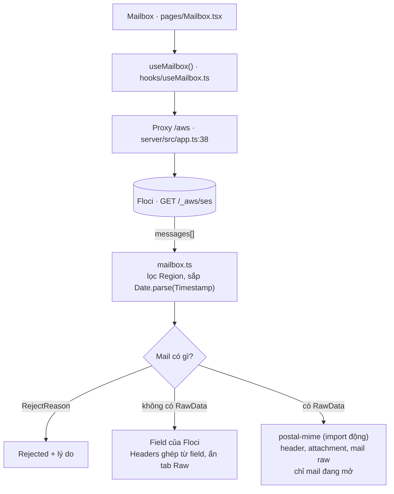

# SES — Thiết kế

> Ngày: 2026-11-17 · Cập nhật: 2026-11-18 (đối chiếu với code và Floci, mục 7; cắt phạm vi theo ponytail ultra, mục 9) · Trạng thái: chờ duyệt · Thuộc: [Local Console](2026-11-09-localconsole-design.md) · [Roadmap](../roadmap.md): đợt 2

## 1. Mục tiêu

Làm màn hình SES cho dev local. Trọng tâm là một **hộp thư local**: Floci không gửi mail thật mà lưu lại mọi mail app đã gửi. Dev dùng để:

- Xem app đã gửi mail chưa (xác nhận đăng ký, quên mật khẩu, thông báo…), gửi cho ai, nội dung ra sao.
- Bấm link trong mail (link xác nhận, reset mật khẩu) để đi tiếp flow trên app local.
- Thêm địa chỉ gửi đi (identity): Floci từ chối gửi từ địa chỉ chưa verify, giống AWS.
- Xem template đã có trên local (app dùng template mà thiếu thì gửi lỗi).

Identity, template: AWS SDK (SES v2) qua proxy `/aws`. Hộp thư: endpoint riêng của Floci `/_aws/ses` (không có trên AWS), cũng qua proxy. **Server không phải sửa gì.**

Đối chiếu với [tài liệu SES của Floci](https://floci.io/floci/services/ses/) và đã chạy thử trên Floci 2.4.0 (mục 7).

---

## 2. Phạm vi

**Nguyên tắc chọn** (user chốt 2026-11-17): chỉ làm tính năng (1) dev thường dùng khi code, chạy local, test, hoặc (2) cần để nối với service khác cho trọn flow.

### Làm trong đợt này

| Nhóm        | Tính năng                                                                               | Lý do giữ                                              |
| ----------- | --------------------------------------------------------------------------------------- | ------------------------------------------------------ |
| Hộp thư     | Danh sách mail (mới nhất trên), lọc theo người nhận / người gửi / subject, Auto refresh | "App đã gửi mail chưa?" — lý do chính để làm SES       |
| Xem mail    | HTML (như hộp thư thật), Text, Headers, Raw (khi có MIME); tải attachment               | Kiểm nội dung; **bấm link** để đi tiếp flow            |
| Dọn hộp thư | Xóa từng mail, xóa hết mail của region                                                  | Dọn trước khi test lại                                 |
| Identity    | Danh sách, thêm email (verify ngay), xóa                                                | Thiếu thì app gửi lỗi `MessageRejected`                |
| Template    | Danh sách, xem (subject, HTML, text), xóa                                               | App dùng template thì local phải có: kiểm đã có chưa   |

### Để sau

| Tính năng                                                   | Ghi chú                                                                                     |
| ----------------------------------------------------------- | ------------------------------------------------------------------------------------------- |
| Configuration set (tạo, liệt kê, xóa)                       | Chỉ cần khi app gửi kèm `ConfigurationSetName` mà set chưa có (lỗi rõ ràng, làm thêm nhanh) |
| Domain identity                                             | Floci để Pending tới khi có bản ghi DKIM trong Route 53. Verify từng email là đủ            |
| Thông báo bounce/complaint qua SNS (địa chỉ giả lập bounce) | Làm cùng service SNS                                                                        |
| Tạo, sửa, xem trước template                                | Template local thường do CDK / script seed tạo; sửa ở console thành 2 nơi giữ template      |
| Gửi mail thử từ console (kể cả attachment, bulk)            | Mail app gửi mới là bài test thật; thiếu identity đã có lỗi `MessageRejected`               |
| Ảnh inline `cid:` trong mail HTML                           | Logo nhúng trong mail không hiện. `postal-mime` có `contentId`, đổi sang blob URL khi cần   |

### Không làm

| Tính năng                                                                   | Lý do                                                      |
| --------------------------------------------------------------------------- | ---------------------------------------------------------- |
| Suppression list, event destination, open/click tracking, VDM, dedicated IP | Floci chỉ lưu hoặc không chạy thật                         |
| Contact list, import/export, tenant                                         | Chuyện marketing / production                              |
| Receipt rule (nhận mail đến)                                                | Floci chỉ lưu, không nhận mail                             |
| Custom verification template                                                | Email verify ngay khi tạo, không có bước gửi mail xác nhận |
| Cấu hình SMTP relay (Mailpit…)                                              | Là biến môi trường của Floci, không phải việc của console  |
| Account, sandbox, quota                                                     | Floci không có sandbox                                     |

---

## 3. Màn hình

Theo quy tắc chung của DynamoDB, ElastiCache, MQ, SQS: chỉ dùng component và token của Cloudscape; mỗi vùng một nút chính; thiếu giá trị là "—"; khung hẹp thì bảng thành hai tầng (`useIsCompact`); khối rỗng hoặc lỗi vẫn giữ khung.

Menu trái: **Mailbox**, **Identities**, **Templates**. Mở `/ses` vào Mailbox. Home hiện số email trong hộp thư của region (`useResourceCount`, noun `email`).

### 3.1 Hộp thư — `/ses/mailbox`

```text
Mailbox (3)              Auto refresh [○]  [↻] [Delete] [Delete all]
Emails your app sent through SES in ap-southeast-1. Nothing is delivered.
[🔍 Find by recipient, sender or subject      ]
 ☐ To                     Subject                      From                  Sent
 ☐ user@example.com       Confirm your account         noreply@app.local     10:20:01
 ☐ user@example.com       Reset your password          noreply@app.local     10:18:44
 ☐ admin@example.com      📎 Weekly report             reports@app.local     09:02:10
```

- Đọc `GET /_aws/ses` (trả `{ messages: [...] }`, cũ nhất trước), **lọc theo region của console** (hộp thư của Floci dùng chung mọi region, mỗi mail có trường `Region`), sắp mới nhất trên bằng `Date.parse(Timestamp)`: `Timestamp` có 6–9 chữ số lẻ nên không so chuỗi.
- Ô tìm lọc phía trình duyệt theo To/Cc/Bcc, From, Subject (endpoint của Floci chỉ lọc theo người gửi).
- Nhiều người nhận: hiện người đầu kèm "+2". Có attachment: biểu tượng 📎 cạnh subject.
- Mail bị Floci chặn (có `RejectReason`, không có nội dung): cột Subject hiện `StatusIndicator` lỗi "Rejected" kèm lý do.
- Bấm dòng: mở **split panel** xem mail (3.2). Giống panel giá trị của ElastiCache.
- **Auto refresh** (`Toggle`): tải lại mỗi 5 giây. Mặc định tắt.
- **Delete** (nhiều mail đã chọn), **Delete all** (mọi mail của region này): gõ `delete` để xác nhận. Không gọi `DELETE /_aws/ses` (xóa cả region khác) mà xóa từng mail theo ID.
- Khung hẹp: tầng 1 là subject + giờ, tầng 2 là người nhận.
- Rỗng: "No emails yet. Emails your app sends through SES show up here."

### 3.2 Xem mail (split panel)

```text
Confirm your account                                              [Delete]
From  noreply@app.local          Sent  2026-11-17 10:20:01
To    user@example.com
[HTML] [Text] [Headers] [Raw]
┌────────────────────────────────────────────────┐
│  Welcome! Click to confirm: [Confirm account]  │
└────────────────────────────────────────────────┘
Attachments: report.pdf (12 KB) [Download]
```

- **HTML:** hiện trong `iframe` **sandbox, không cho chạy script** (`sandbox="allow-popups allow-popups-to-escape-sandbox"`, `srcdoc`, thêm `<base target="_blank">`). Link mở tab mới, nên bấm link xác nhận trỏ về app local được. Khung cao cố định, cuộn bên trong (như `ObjectPreview` của S3, 70vh): iframe sandbox không đo được chiều cao nội dung. Ảnh từ ngoài vẫn tải (chấp nhận ở local); ảnh `cid:` để sau.
- **Text:** phần text của mail. **Headers:** bảng header. Mail có `RawData`: lấy từ MIME. Mail không có `RawData`: ghép từ field của Floci (From ← `Source`, Return-Path ← `ReturnPath`, To/Cc/Bcc ← `Destination`, Reply-To ← `ReplyToAddresses`, Subject, Date ← `Timestamp`, cộng header tùy chỉnh trong `Headers`). **Raw:** MIME gốc (`CodeSnippet`, copy được), **chỉ hiện khi mail có `RawData`**.
- Mail không có HTML: mở tab Text. Mail gửi bằng `SendRawEmail` chỉ có MIME gốc (không có subject, người nhận, body tách sẵn): console tự đọc MIME (mục 4). Ngược lại, mail `SendEmail` simple/template không có attachment chỉ có field, **không có `RawData`**.
- Attachment: tên, kích thước, nút Download (lấy nội dung từ MIME gốc, tải bằng `downloadBlob` chung, mục 6).
- Mail bị chặn (`RejectReason`): panel chỉ hiện lý do, không có tab.

### 3.3 Identities — `/ses/identities`

```text
Identities (2)                                          [↻] [Delete] [Add email]
Addresses your app can send from. Floci verifies an email as soon as you add it.
 ☐ Identity                  Type      Status
 ☐ noreply@app.local         Email     Verified
 ☐ app.local                 Domain    ◔ Pending
```

- `ListEmailIdentities`. Domain identity (do CDK tạo) vẫn hiện để xem; thêm domain từ console để sau.
- **Add email (modal):** Email address. `CreateEmailIdentity`. Đã có thì báo lỗi gốc.
- **Delete:** gõ `delete`. Cảnh báo: app gửi từ địa chỉ này sẽ bị từ chối.

### 3.4 Templates — `/ses/templates`

```text
Templates (2)                                           [↻] [Delete]
 ☐ Name ▲                     Created
 ☐ welcome-email              2026-11-17 09:00:00
```

- `ListEmailTemplates`. Bấm dòng: split panel (như 3.2) gọi `GetEmailTemplate`, hiện Subject và tab **HTML** (cùng `iframe` sandbox ở 3.2, biến `{{name}}` giữ nguyên) / **Text**.
- **Delete:** gõ `delete`. Cảnh báo app gửi bằng template này sẽ lỗi.
- Rỗng: "No templates yet. Templates your app or CDK creates show up here."

### 3.5 Các modal xác nhận

| Thao tác             | Xác nhận                                                   |
| -------------------- | ---------------------------------------------------------- |
| Delete email(s)      | Gõ `delete`. Báo số mail                                   |
| Delete all           | Gõ `delete`. Ghi rõ chỉ xóa mail của region hiện tại       |
| Delete identity(ies) | Gõ `delete`. Cảnh báo app gửi từ địa chỉ này sẽ bị từ chối |
| Delete template(s)   | Gõ `delete`. Cảnh báo app gửi bằng template này sẽ lỗi     |

---

## 4. Cách hoạt động của một số thao tác

| Thao tác           | Gọi                                                                                                                                                                                        |
| ------------------ | ------------------------------------------------------------------------------------------------------------------------------------------------------------------------------------------ |
| Hộp thư            | `GET /aws/_aws/ses` → `{ messages }` → lọc `Region` = region của console → sắp theo `Date.parse(Timestamp)`. Không cần header `Authorization` (khác peek SQS)                                                                                  |
| Xóa mail           | `DELETE /aws/_aws/ses?id=<id>` từng mail (id lạ không xóa gì). Xóa nhiều mail: báo kết quả bằng `notifyBulkOutcome`                                                                                                                                                   |
| Đọc nội dung mail  | Có `RejectReason`: không có nội dung, chỉ hiện lý do. Mail có sẵn `Subject`, `Destination`, `Body.text_part` / `html_part` thì dùng luôn. Header, attachment, mail `SendRawEmail`: đọc MIME trong `RawData` (base64) bằng thư viện `postal-mime`, nạp bằng `import()` động, chỉ đọc mail đang mở. Không có `RawData`: Headers ghép từ field |
| Identity, template | SES v2: `ListEmailIdentities`, `CreateEmailIdentity`, `DeleteEmailIdentity`, `ListEmailTemplates`, `GetEmailTemplate`, `DeleteEmailTemplate`                                                 |

Đường đọc hộp thư (file trong `web/src/services/ses/`):



Identity và template của SES v1 và v2 dùng chung (mục 7 #4): app dùng v1 hay v2 đều thấy trên console.

---

## 5. Trạng thái và lỗi

| Tình huống                                     | Hiển thị                                                         |
| ---------------------------------------------- | ---------------------------------------------------------------- |
| `RawData` không đọc được                       | HTML/Text lấy từ field nếu có, không có thì hiện "Can't read this email"; tab Raw vẫn xem được |
| Hộp thư lỗi (Floci đổi endpoint)               | Khung bảng hiện lỗi; Identities, Templates vẫn dùng được         |
| Mail bị Floci chặn (`RejectReason`)            | Dòng "Rejected" kèm lý do; panel chỉ hiện lý do                  |
| Mail không có `RawData`                        | Ẩn tab Raw; Headers ghép từ field                                |

---

## 6. Kỹ thuật

### Package cần cài

User tự chạy (từ thư mục gốc repo):

```bash
npm install @aws-sdk/client-sesv2 postal-mime -w web
```

- `@aws-sdk/client-sesv2`: identity, template.
- `postal-mime`: đọc MIME (header, multipart, quoted-printable, base64, attachment) trong trình duyệt. Tự viết bộ đọc MIME dễ sai ở các trường hợp lồng nhau và header mã hóa, nên dùng thư viện. Server không cần.

### Cấu trúc thư mục

```bash
web/src/services/ses/
├── index.tsx, routes.ts, constants.ts, schemas.ts
├── mailbox.ts                 # gọi /_aws/ses, lọc region, sắp; đọc MIME (postal-mime import động); ghép Headers từ field
├── hooks/
│   ├── useSES.ts              # SESv2Client qua /aws
│   ├── useMailbox.ts          # list, delete
│   ├── useIdentities.ts       # list, create, delete
│   └── useTemplates.ts        # list, get, delete
├── pages/                     # Mailbox, Identities, Templates
└── components/                # EmailPanel, TemplatePanel, HtmlPreview (iframe sandbox), các modal
```

Khai báo trong `registry.ts`; icon `web/public/icons/ses.svg` theo cùng khung với các icon cũ.

### Dùng lại từ phần đã có

| Thành phần                                                                          | Dùng cho                               |
| ----------------------------------------------------------------------------------- | -------------------------------------- |
| `ActionBar`, `refreshAction`, `ConfirmModal`, `ModalFooter`                         | Header bảng, modal xác nhận            |
| `FormModal`, `FormInput` (`form/FormFields.tsx`), `useZodForm`                     | Add email                              |
| `CodeSnippet`, `CopyButton`                                                         | Tab Text, Raw                          |
| `useSplitPanel`                                                                     | Panel xem mail, xem template           |
| `EmptyState`, `emptyOrError`, `ErrorState`, `NotFound`, `useIsCompact`, `notifySuccess` / `notifyError` / `notifyBulkOutcome` (`hooks/useNotify.ts`), `formatDate`, `pluralize` | Trạng thái, khung hẹp, thông báo, ngày |
| `ObjectPreview` của S3 (mẫu khung 70vh)                                             | Khung iframe HTML                      |

### Sửa phần dùng chung

| File                                                     | Từ                                                       | Thành                                                                                                                                                         | Ảnh hưởng                                                                                                                                                                                                       |
| -------------------------------------------------------- | -------------------------------------------------------- | ------------------------------------------------------------------------------------------------------------------------------------------------------------- | --------------------------------------------------------------------------------------------------------------------------------------------------------------------------------------------------------------- |
| `web/src/services/dynamodb/hooks/useItems.ts:205`        | `downloadText` riêng của DynamoDB                        | `downloadBlob(fileName, data, type)` trong `web/src/shared/download.ts`                                                                                       | 1 chỗ gọi: `useItems.ts:223` (Export table)                                                                                                                                                                      |

---

## 7. Rủi ro đã kiểm tra

Chạy thử trên Floci 2.4.0 qua proxy `/aws` của console ngày 2026-11-17, region `ap-southeast-1`. Identity, template đã xóa. **Mail thử chưa xóa:** 6 mail còn trong hộp thư `ap-southeast-1` (dọn bằng `DELETE /_aws/ses?id=`).

| #   | Rủi ro                                         | Kết quả                                                                                                                                                                            |
| --- | ---------------------------------------------- | ---------------------------------------------------------------------------------------------------------------------------------------------------------------------------------- |
| 1   | **SES v1 (Query) và v2 (REST JSON) qua proxy** | **Ổn.** v1: `VerifyEmailIdentity`, `SendEmail`, `SendRawEmail`, `CreateTemplate`, `SendTemplatedEmail`. v2: identity, template, render, `SendEmail` (simple, template, attachment) |
| 2   | **Gửi từ địa chỉ chưa verify**                 | Bị từ chối `MessageRejected` ("Email address is not verified…"), giống AWS. Thêm identity email → gửi được ngay                                                                    |
| 3   | **Hộp thư qua proxy**                          | **Ổn**, không cần header `Authorization`. Có `Subject`, `Destination`, `Body.text_part` / `html_part`, `Attachments` (tên, kiểu, kích thước), `RawData` (base64)                   |
| 4   | **Identity v1 và v2 dùng chung**               | **Ổn.** Tạo bằng v1, thấy ở `ListEmailIdentities` v2. Identity theo region: region khác không thấy                                                                                 |
| 5   | **Hộp thư dùng chung mọi region**              | Mỗi mail có `Region` → console lọc theo region của mình; không dùng `DELETE /_aws/ses` (xóa hết mọi region)                                                                        |
| 6   | **Mail `SendRawEmail`**                        | Chỉ có `RawData`, **không có** subject / người nhận / body tách sẵn → phải đọc MIME                                                                                                |
| 7   | **Attachment**                                 | Hộp thư chỉ có metadata; nội dung nằm trong `RawData` → tải về phải đọc MIME                                                                                                       |
| 8   | **Xem trước template**                         | `TestRenderEmailTemplate` trả MIME đầy đủ (multipart text + HTML). Thiếu biến → `BadRequestException` "Attribute 'name' is not present in the rendering data."                     |
| 9   | **Template gửi thật**                          | `SendTemplatedEmail` / v2 `SendEmail` template: hộp thư có subject và body đã điền dữ liệu                                                                                         |
| 10  | **Lọc của Floci**                              | `?email=` chỉ khớp **người gửi** → lọc người nhận làm phía trình duyệt                                                                                                             |

Kiểm thêm ngày 2026-11-18, **chỉ đọc** (GET hộp thư, [tài liệu SES của Floci](https://floci.io/floci/services/ses/)), không ghi vào Floci (trừ #20–21: gửi thử bằng probe, đã xóa sau đó):

| #   | Rủi ro                                  | Kết quả                                                                                                                                         |
| --- | --------------------------------------- | ----------------------------------------------------------------------------------------------------------------------------------------------- |
| 11  | **Hộp thư sau khi khởi động lại Floci** | **Ổn.** Mail gửi lúc 17:16–17:17Z, Floci khởi động lại lúc 17:17:32Z (`FLOCI_STORAGE_MODE: hybrid`), mail vẫn còn                               |
| 12  | **Mail không có `RawData`**             | `SendEmail` simple/template không có attachment: chỉ có field, không có `RawData` → ẩn tab Raw, Headers ghép từ field                           |
| 13  | **Cc**                                  | Nằm ở `Destination.CcAddresses`                                                                                                                 |
| 14  | **Shape của hộp thư**                   | `{ messages: [...] }`, cũ nhất trước. Có thêm `ReturnPath`, `ReplyToAddresses`, `Headers` (header tùy chỉnh). `Timestamp` có 6–9 chữ số lẻ      |
| 15  | **`Id` = `MessageId`**                  | `RawData` có `Message-ID: <Id@email.amazonses.com>`; tài liệu: phần trước `@` là `MessageId` trả về → dùng khi làm Gửi thử (đang để sau)             |
| 16  | **Xóa / lấy một mail**                  | Tài liệu: `DELETE ?id=` chỉ xóa mail đó, id lạ không xóa gì; `GET ?id=` trả một mail                                                            |
| 17  | **Mail bị chặn**                        | Tài liệu: mail bị content-scan chặn chỉ có `RejectReason`, không có nội dung                                                                    |
| 18  | **HTML có script, ảnh ngoài**           | Hộp thư có mail thật chứa `<script>` và ``: iframe sandbox (3.2) là bắt buộc; ảnh ngoài vẫn tải (chấp nhận ở local)          |
| 19  | **Không phân trang**                    | Mỗi lần tải trả `RawData` của mọi mail → chỉ đọc MIME của mail đang mở. Chấp nhận ở local                                                    |
| 20  | **Bcc**                                 | Gửi thử ngày 2026-11-18 (v2 `SendEmail` simple, đã xóa mail và identity thử): nằm ở `Destination.BccAddresses`, cạnh `ToAddresses`              |
| 21  | **`Headers`**                           | Cùng mail thử: `Headers: [{ "Name": "X-Lc-Probe", "Value": "1" }]`, giống `MessageHeader` của SES v2. Mail không có header tùy chỉnh thì không có field này |

---

## 8. Thứ tự làm

1. User cài package (mục 6). Icon, khai báo trong `registry.ts` (Home đếm email), `useSES`.
2. Phần dùng chung (mục 6): `downloadBlob` (Export của DynamoDB chuyển sang dùng).
3. Identities: danh sách, thêm, xóa.
4. Hộp thư: danh sách, lọc, Auto refresh, xóa, mail Rejected; `mailbox.ts` đọc MIME.
5. Panel xem mail: HTML (iframe sandbox), Text, Headers (từ MIME hoặc ghép từ field), Raw (khi có `RawData`), attachment.
6. Templates: danh sách, xem (split panel), xóa.
7. Test: unit cho `mailbox.ts` (lọc region, sắp `Timestamp`, đọc MIME raw, attachment, mail không có `RawData`, mail `RejectReason`, Headers ghép từ field) và schemas; integration `tests/it/ses.test.ts`; E2E một luồng chính; thêm SES vào `tests/it/leftovers.mjs` (identity, template `lc-it-*` / `lc-e2e-*`, mail có `Source` mang tiền tố đó).

**Kiểm tra:** chạy trên Floci thật, chụp 1440, 1024 và 390px, không trang nào cuộn ngang. Trọn luồng (mail gửi từ app hoặc script SDK): gửi từ địa chỉ chưa có → `MessageRejected` → thêm identity trên console → gửi lại (simple, template, attachment, `SendRawEmail`) → mail hiện trong hộp thư, HTML đúng, bấm link mở tab mới → attachment tải về được → mail `SendRawEmail` đọc được subject, body → template hiện ở Templates, xem được, xóa được → xóa mail, Delete all (chỉ region hiện tại). Thêm: HTML có `<script>` không chạy; mail không có `RawData` không có tab Raw, Headers vẫn đủ; Home hiện số email của region; Export của DynamoDB vẫn tải được sau khi đổi sang `downloadBlob`.

---

## 9. Quyết định

| Quyết định                                          | Lý do                                                                                 |
| --------------------------------------------------- | ------------------------------------------------------------------------------------- |
| Chọn tính năng theo 2 tiêu chí (dev dùng, nối flow) | User chốt 2026-11-17                                                                  |
| Configuration set, domain identity để sau           | User chốt 2026-11-17                                                                  |
| Hộp thư qua endpoint riêng của Floci `/_aws/ses`    | AWS không có API đọc mail đã gửi; đây là giá trị chính của SES ở local                |
| Dùng SES v2 cho identity, template                  | Một package, API JSON gọn; v1 và v2 dùng chung dữ liệu nên app dùng bản nào cũng thấy |
| Lọc region phía trình duyệt, xóa từng mail theo ID  | Hộp thư của Floci dùng chung mọi region                                               |
| HTML trong `iframe` sandbox, không cho chạy script  | Mail do app tạo, có thể chứa script; link vẫn mở được ở tab mới                       |
| Đọc MIME bằng `postal-mime`                         | Cần cho mail raw, attachment; tự viết dễ sai                        |
| Xem mail trong split panel, không có trang riêng    | Giống hộp thư mail và panel của ElastiCache; xem nhiều mail liên tiếp nhanh           |
| Mail không có `RawData`: ẩn tab Raw, Headers ghép từ field | Floci không lưu MIME cho mail simple/template không attachment; không tự dựng MIME giả (user chốt 2026-11-18) |
| Home đếm số email trong hộp thư của region          | Hộp thư là giá trị chính của SES ở local (user chốt 2026-11-18)                        |
| `postal-mime` nạp bằng `import()` động              | Chỉ cần khi mở mail có MIME; không làm nặng bundle chung        |
| `downloadBlob` dùng chung                            | Sửa hàm có sẵn của DynamoDB thay vì viết hàm tải riêng cho SES                        |
| Bcc: đọc `Destination.BccAddresses` nếu có          | Tài liệu Floci không nhắc; kiểm trên Floci khi làm (mục 7), sai thì sửa 3.1 và 3.2    |
| Template chỉ list, xem, xóa; tạo/sửa/preview để sau | Template local thường do CDK / script seed tạo; tránh 2 nơi giữ template (user chốt 2026-11-18, ponytail ultra) |
| Gửi mail thử để sau                                 | Mail app gửi mới là bài test thật; thiếu identity đã có `MessageRejected` (user chốt 2026-11-18) |
| Không cache kết quả đọc MIME                        | Chỉ đọc mail đang mở; TanStack Query đã giữ dữ liệu hộp thư (user chốt 2026-11-18)   |
