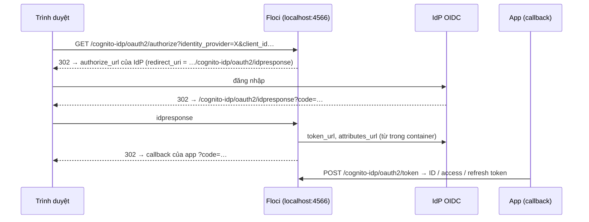

# Cognito User Pools — Thiết kế

> Ngày: 2026-11-19 · Trạng thái: đã duyệt (2026-11-19) · Thuộc: [Local Console](2026-11-09-localconsole-design.md) · [Roadmap](../roadmap.md): đợt 2, làm sau [SES](2026-11-17-ses-design.md) và [SNS](2026-11-18-sns-design.md)

## 1. Mục tiêu

Làm màn hình Cognito User Pools giống AWS Cognito Console. Dev local dùng để:

- Tạo user, xác nhận, đặt / đặt lại mật khẩu, bật/tắt, xếp vào group để test flow đăng nhập của app.
- Đăng nhập thử bằng app client, xem token đã decode (claims, `cognito:groups`), copy token để gọi API.
- Lấy issuer, JWKS URL cho backend kiểm JWT (API Gateway authorizer, middleware của app).
- Gắn Lambda trigger (pre sign-up, post confirmation, pre token generation…) và thấy nó chạy thật ở local.
- Thử đăng nhập federated qua IdP OIDC / Google bằng hosted UI của Floci.
- Xem mail mã xác minh / thư mời (SES) và SMS (SNS) mà Cognito gửi cho user.

**Một service** "Cognito", sidebar chỉ có **User pools**. Mọi thao tác gọi thẳng Floci bằng AWS SDK qua proxy `/aws`. **Server không phải sửa gì.**

Đối chiếu với [tài liệu Cognito của Floci](https://floci.io/floci/services/cognito/) và đã chạy thử trên Floci 2.4.0 (mục 7).

---

## 2. Phạm vi

**Nguyên tắc chọn** (user chốt 2026-11-17, bổ sung 2026-11-19): tính năng thỏa (1) dev thường dùng khi code, chạy local, test, **hoặc** (2) cần để nối với service khác cho trọn flow — **(2) là tiêu chí quan trọng** — **và** (3) Floci hỗ trợ toàn phần hoặc một phần (một phần vẫn làm, ghi rõ chỗ thiếu).

### Làm trong đợt này

| Nhóm                       | Tính năng                                                                                                                                                                                             | Floci 2.4.0                                                              |
| -------------------------- | ----------------------------------------------------------------------------------------------------------------------------------------------------------------------------------------------------- | ------------------------------------------------------------------------ |
| User pool                  | Liệt kê, tạo tối giản (tên, đăng nhập bằng username hay email, tự xác minh email), xóa                                                                                                                | Toàn phần (không phân trang, 7 #13)                                      |
| Pool: Details              | Pool ID, ARN, thuộc tính đăng nhập, password policy, MFA (chỉ xem), **issuer, JWKS URL, openid-configuration URL** (copy)                                                                             | Toàn phần (7 #15)                                                        |
| App client                 | Liệt kê, tạo (tên, secret, auth flows, callback URL, OAuth flows / scopes, `SupportedIdentityProviders`), xem secret, xóa                                                                             | Toàn phần                                                                |
| User                       | Danh sách, lọc username / email / status (ở client), status, enabled                                                                                                                                  | Một phần: không phân trang, `Limit` bị bỏ qua (7 #13)                    |
| User: tạo                  | `AdminCreateUser`: username, email, phone, mật khẩu tạm, thư mời qua Email / SMS (`DesiredDeliveryMediums`)                                                                                           | Toàn phần (7 #3, #4, #5)                                                 |
| User: chi tiết             | Attribute (kể cả custom, `identities` của user federated), group đang thuộc; sửa / xóa attribute, bật/tắt `email_verified`                                                                            | Một phần: custom attribute chưa khai báo vẫn lưu (7 #10)                 |
| User: thao tác             | Confirm (`AdminConfirmSignUp`), đặt mật khẩu (permanent / temporary), reset mật khẩu, enable/disable, global sign out, xóa                                                                            | Một phần: reset không gửi mail (7 #9)                                    |
| Group                      | Liệt kê, tạo (tên, mô tả, precedence), xóa, thêm / bớt user                                                                                                                                           | Toàn phần                                                                |
| Test sign-in               | Chọn app client, username / password → `InitiateAuth USER_PASSWORD_AUTH`; `NEW_PASSWORD_REQUIRED`; `SECRET_HASH` khi client có secret; ID / access token đã decode, copy token                        | Một phần: `RespondToAuthChallenge` bắt `USERNAME` = `sub` (7 #7)         |
| Lambda trigger             | Tab Triggers: xem, **sửa** (thêm / đổi / gỡ) pre sign-up, post confirmation, pre / post authentication, pre token generation, custom message, define / create / verify auth challenge, user migration | Toàn phần, chạy thật (7 #12); thiếu `PreSignUp_ExternalProvider` (7 #16) |
| Federated IdP              | Liệt kê, tạo, sửa, xóa IdP **OIDC** và **Google** (client ID / secret, scope, URL, **attribute mapping**); gắn IdP vào app client                                                                     | OIDC toàn phần (7 #16); Google theo tài liệu, chưa kiểm                  |
| Domain, hosted UI          | Tạo / xóa domain của pool; link đăng nhập thử qua hosted UI                                                                                                                                           | Một phần: hosted UI chỉ có form sign-in (7 #17)                          |
| Liên kết: SES              | Details: cấu hình gửi mail (From, SES identity, link sang SES); sửa bằng dropdown identity (`EmailConfiguration` `DEVELOPER` + `SourceArn`). Chi tiết user: link **View emails** sang hộp thư SES     | Toàn phần (7 #4)                                                         |
| Liên kết: SNS (SMS)        | Chi tiết user: link **View SMS** sang trang SMS, lọc theo số điện thoại. Trang SMS thuộc [spec SMS](2026-11-19-sms-design.md) (user chốt 2026-11-19); chưa có trang thì ẩn link                       | (2)                                                                      | Toàn phần (Floci lưu SMS ở `/_aws/sns`) |
| Liên kết: Lambda           | Lambda › Triggers hiện nguồn Cognito (chỉ xem, link sang pool)                                                                                                                                        | Toàn phần                                                                |
| Liên kết: API Gateway, CFN | Cognito chỉ giữ route ổn định `/cognito/user-pools/:poolId`; link ngược là việc của spec API Gateway / CloudFormation                                                                                 | —                                                                        |

### Để sau

| Tính năng                              | Ghi chú                                                                 |
| -------------------------------------- | ----------------------------------------------------------------------- |
| Resource server, custom scope          | Đoán dev ít dùng                                                        |
| Cấu hình MFA                           | Đoán dev ít dùng; Details chỉ hiện trạng thái                           |
| Tag                                    | Đoán dev ít dùng                                                        |
| Custom email / SMS sender trigger      | Cần KMS. Trigger có sẵn (do IaC tạo) vẫn hiện và được giữ khi sửa (3.7) |
| Test sign-up, quên mật khẩu tự phục vụ | Đoán dev ít dùng; tạo user bằng admin + Test sign-in là đủ              |
| IdP Facebook, Amazon, Apple, SAML      | Floci không có                                                          |

### Không làm

| Tính năng                                                                   | Lý do                                                                                                                                                                                                         |
| --------------------------------------------------------------------------- | ------------------------------------------------------------------------------------------------------------------------------------------------------------------------------------------------------------- |
| **Identity pool**                                                           | Floci chỉ có phần quản lý; `GetId`, `GetCredentialsForIdentity`, `GetOpenIdToken`, `ListIdentities` trả `UnknownOperationException` → app dùng Amplify Storage / `fromCognitoIdentityPool` không chạy ở local |
| Passkey / WebAuthn, branding                                                | Floci lưu nhưng không chạy                                                                                                                                                                                    |
| Auth events, devices, import user CSV, risk configuration, UI customization | Floci 2.4.0 trả `UnsupportedOperation` (7 #18)                                                                                                                                                                |

---

## 3. Màn hình

Theo quy tắc chung của DynamoDB, ElastiCache, MQ, SQS, SNS, EventBridge: chỉ dùng component và token của Cloudscape; mỗi vùng một nút chính; cột số căn phải (`Figure`); thiếu giá trị là "—"; khung hẹp thì bảng thành hai tầng (`useIsCompact`); khối rỗng hoặc lỗi vẫn giữ khung.

Sidebar: **User pools**. Home đếm số user pool (`useResourceCount`, noun `user pool`).

### 3.1 User pools — `/cognito/user-pools`

```text
User pools (2)                                       [↻] [Delete] [Create user pool]
[🔍 Find user pools by name        ]
 ☐ Name ▲            Pool ID                          Created
 ☐ my-app-users      ap-southeast-1_AbC123xyz         2026-11-19 09:00:00
 ☐ admin-users       ap-southeast-1_XyZ987abc         2026-11-18 14:20:11
```

- `ListUserPools` (paginator, Floci trả hết trong một trang). Bấm tên mở chi tiết.
- **Create user pool (modal):**

| Trường            | Ghi chú                                                                                                                  |
| ----------------- | ------------------------------------------------------------------------------------------------------------------------ |
| Name              | 1–128 ký tự: chữ, số, khoảng trắng, `+ = , . @ -` (luật của AWS)                                                         |
| Sign-in with      | `Tiles`: Username / Email. Email → `UsernameAttributes: ["email"]`. Mô tả: "Can't be changed after the pool is created." |
| Auto-verify email | `Checkbox`, mặc định bật → `AutoVerifiedAttributes: ["email"]` (Cognito gửi mã xác minh qua SES)                         |

`CreateUserPool`, còn lại để mặc định. Tạo xong mở trang chi tiết.

- **Delete (nhiều):** gõ `delete`, liệt kê pool. Pool có domain: xóa domain trước (`DeleteUserPoolDomain`) rồi `DeleteUserPool` (luật của AWS; Floci chưa kiểm, 7 chưa kiểm).
- Khung hẹp: tầng 1 là tên, tầng 2 là Pool ID.

### 3.2 Chi tiết pool — `/cognito/user-pools/:poolId`

```text
my-app-users                                  [Delete] [Test sign-in]
ap-southeast-1_AbC123xyz · Sign-in with email · 12 users
[Users] [Groups] [App clients] [Identity providers] [Triggers] [Details]
```

- `DescribeUserPool`. Tab lưu trên URL (`?tab=`). **Mặc định mở Users.**
- **Test sign-in** mở modal 3.9.
- Pool không tồn tại (`ResourceNotFoundException`): "User pool … not found" kèm link về danh sách.
- `StackLink` trong header: type `AWS::Cognito::UserPool`, physical ID = pool ID ([spec CloudFormation](2026-11-19-cloudformation-design.md) 3.8).
- Route `/cognito/user-pools/:poolId` giữ ổn định: API Gateway (authorizer) và CloudFormation (resource) link vào đây (3.11).

### 3.3 Tab Users

```text
Users (3)                                      [↻] [Actions ▾] [Create user]
[🔍 Find by username or email  ] Status: [Any status ▾]
 ☐ Username                    Email                 Status                  Enabled
 ☐ 6f1c…-b2a9                  an@example.com        Confirmed               ● Enabled
 ☐ 0d3e…-77c1                  binh@example.com      ◔ Force change password ● Enabled
 ☐ Google_1a2b…                chi@gmail.com         External provider       ○ Disabled
```

- `ListUsers` (paginator). Floci bỏ qua `Limit`, không có `PaginationToken` → lọc **ở client**: ô tìm khớp username và attribute `email`; `Select` status (`UNCONFIRMED`, `CONFIRMED`, `FORCE_CHANGE_PASSWORD`, `RESET_REQUIRED`, `EXTERNAL_PROVIDER`…).
- Username dài (UUID khi pool đăng nhập bằng email) cắt giữa, tooltip đầy đủ. Bấm username mở chi tiết user (3.4).
- Actions (chọn dòng): **Confirm** (chỉ dòng `UNCONFIRMED`), **Enable**, **Disable**, **Delete** (nhiều, gõ `delete`).
- Khung hẹp: tầng 1 là username + status, tầng 2 là email + enabled.

**Create user (modal):**

| Trường                 | Ghi chú                                                                                                                         |
| ---------------------- | ------------------------------------------------------------------------------------------------------------------------------- |
| Username               | Chỉ hiện khi pool đăng nhập bằng username. Bắt buộc                                                                             |
| Email                  | Bắt buộc khi pool đăng nhập bằng email hoặc khi gửi thư mời qua Email                                                           |
| Mark email as verified | `Checkbox`, mặc định bật → `email_verified=true`                                                                                |
| Phone number           | Tùy chọn, dạng E.164 (`+84…`). Bắt buộc khi gửi thư mời qua SMS. Mô tả: "Floci doesn't send real SMS. Any number works."        |
| Temporary password     | Bắt buộc khi không gửi thư mời. Mô tả: "The user must set a new password at first sign-in."                                     |
| Send invitation        | `Checkbox` Email, SMS → `DesiredDeliveryMediums`. Không chọn gì → `MessageAction: SUPPRESS` (Floci chỉ gửi khi có medium, 7 #3) |

`AdminCreateUser`. User mới ở `FORCE_CHANGE_PASSWORD`. Lỗi trigger pre sign-up (`UserLambdaValidationException`) hiện lỗi gốc trong form. Thông báo thành công kèm nút **View emails** khi gửi qua Email.

### 3.4 Chi tiết user — `/cognito/user-pools/:poolId/users/:username`

```text
an@example.com                          [Delete] [Actions ▾] [Set password]
Confirmed · Enabled · created 2026-11-19 09:12:30
```

- `AdminGetUser` + `AdminListGroupsForUser`. User không có: "User … not found" kèm link về tab Users.
- **Set password (modal):** Password + `Toggle` **Permanent** (mặc định bật). `AdminSetUserPassword`. Tắt Permanent → user về `FORCE_CHANGE_PASSWORD`.
- Actions: **Confirm sign-up** (chỉ `UNCONFIRMED`, `AdminConfirmSignUp`), **Reset password** (`AdminResetUserPassword`, modal mô tả: "The user is moved to RESET_REQUIRED and must use forgot password; the code arrives in the SES mailbox. Floci 2.4.0 doesn't email a code at this step."), **Enable** / **Disable**, **Sign out everywhere** (`AdminUserGlobalSignOut`, mô tả: "Revokes the user's refresh and access tokens.").

| Khối       | Nội dung                                                                                                                                                            |
| ---------- | ------------------------------------------------------------------------------------------------------------------------------------------------------------------- |
| General    | Username (copy), `sub` (copy), status, enabled, created / modified. Email kèm link **View emails**; phone kèm link **View SMS** (3.11). `Toggle` **Email verified** |
| Attributes | Bảng Name / Value. Edit (modal một ô), Delete, **Add attribute**                                                                                                    |
| Groups     | Bảng group đang thuộc (link sang group). **Add to group** (`Multiselect` group chưa thuộc), **Remove**                                                              |

- **Email verified:** `AdminUpdateUserAttributes` `email_verified=true/false`.
- **Edit / Add attribute:** `AdminUpdateUserAttributes`. Add chỉ cho chọn attribute có trong `SchemaAttributes` của pool (kể cả `custom:*`) mà user chưa có: Floci lưu cả custom attribute chưa khai báo, AWS thì báo lỗi (7 #10). Đổi `email` → Floci đặt `email_verified=false` và gửi mã (mô tả dưới ô).
- **Delete attribute:** `AdminDeleteUserAttributes`. Khóa với attribute bắt buộc (`Required` trong schema), `sub`, `identities`.
- `identities` (user federated): hiện từng phần tử thành "`providerName` · `userId`", chỉ xem.
- Group: `AdminAddUserToGroup` / `AdminRemoveUserFromGroup` từng group.

### 3.5 Tab Groups và chi tiết group — `/cognito/user-pools/:poolId/groups/:group`

```text
Groups (2)                                          [↻] [Delete] [Create group]
 ☐ Name ▲          Description              Precedence
 ☐ admin           Back-office admins                0
 ☐ editor          —                                10
```

- `ListGroups`. **Create group (modal):** Name (1–128 ký tự), Description (tùy chọn, ≤ 2048), Precedence (số ≥ 0, tùy chọn). `CreateGroup`. **Delete** (nhiều, gõ `delete`): `DeleteGroup`.
- **Chi tiết group:** Name, description, precedence; bảng user (`ListUsersInGroup`) kèm **Add users** (`Multiselect` user của pool chưa trong group) và **Remove**. Mô tả: "Members get this group in the `cognito:groups` claim of their tokens."
- Khung hẹp: tầng 1 là tên + precedence, tầng 2 là mô tả.

### 3.6 Tab App clients, chi tiết, tạo / sửa client

```text
App clients (2)                                     [↻] [Delete] [Create app client]
 ☐ Name ▲          Client ID                    Secret
 ☐ web             4k2j…9a                      —
 ☐ backend         7p1q…3c                      Yes
```

- `ListUserPoolClients`, rồi `DescribeUserPoolClient` từng client (cột Secret). Bấm tên mở chi tiết. **Delete** (nhiều, gõ `delete`): `DeleteUserPoolClient`.

**Chi tiết client — `/cognito/user-pools/:poolId/clients/:clientId`:**

```text
web                                     [Delete] [Open hosted UI] [Edit]
```

| Khối    | Nội dung                                                                                                                             |
| ------- | ------------------------------------------------------------------------------------------------------------------------------------ |
| General | Client ID (copy), secret (ẩn, nút **Show**, copy), auth flows                                                                        |
| OAuth   | Callback URL, sign-out URL, OAuth flows, scopes, identity providers (`SupportedIdentityProviders`, link sang tab Identity providers) |

- **Open hosted UI (modal):** Identity provider `Select` (Cognito form hoặc IdP đã gắn), Callback URL `Select` (trong `CallbackURLs` của client) → mở tab mới tới `${flociPublicUrl}/cognito-idp/oauth2/authorize?client_id&response_type=code&redirect_uri&scope&state` (thêm `identity_provider` khi chọn IdP). Khóa kèm lý do khi pool chưa có domain, client chưa có callback URL hoặc chưa bật code flow. Mô tả: "After sign-in, Floci redirects to your callback with `?code=`. Exchange it at `/cognito-idp/oauth2/token`." Đường dẫn bắt buộc có tiền tố `/cognito-idp` (7 #16).

**Tạo / sửa client — `/cognito/user-pools/:poolId/clients/create`, `…/clients/:clientId/edit`:**

| Trường             | Ghi chú                                                                                                                                                                |
| ------------------ | ---------------------------------------------------------------------------------------------------------------------------------------------------------------------- |
| Name               | 1–128 ký tự                                                                                                                                                            |
| Client secret      | `Tiles`: No secret (app web / mobile) / Generate secret (backend). Mặc định No secret. Khóa khi sửa (luật của AWS)                                                     |
| Auth flows         | `Multiselect` `ALLOW_USER_PASSWORD_AUTH`, `ALLOW_USER_SRP_AUTH`, `ALLOW_REFRESH_TOKEN_AUTH`, `ALLOW_ADMIN_USER_PASSWORD_AUTH`, `ALLOW_CUSTOM_AUTH`. Mặc định 3 cái đầu |
| Callback URLs      | Danh sách URL (thêm / xóa dòng). Bắt buộc khi bật OAuth flow                                                                                                           |
| Sign-out URLs      | Tùy chọn                                                                                                                                                               |
| OAuth flows        | `Checkbox` Authorization code / Implicit / Client credentials (`AllowedOAuthFlows`, bật `AllowedOAuthFlowsUserPoolClient` khi chọn ít nhất một)                        |
| OAuth scopes       | `Multiselect` `openid`, `email`, `profile`, `phone`, `aws.cognito.signin.user.admin`. Mặc định `openid email profile`                                                  |
| Identity providers | `Multiselect`: `COGNITO` + IdP của pool (`SupportedIdentityProviders`). Mặc định `COGNITO`                                                                             |

- Tạo: `CreateUserPoolClient`. Sửa: `UpdateUserPoolClient` với request = `DescribeUserPoolClient` + trường form (AWS reset trường không gửi, 7 #14). Tạo / sửa xong mở chi tiết client.
- Gắn IdP vào client = sửa client, chọn ở ô Identity providers.

### 3.7 Tab Triggers

```text
Lambda triggers                                                        [Edit]
 Trigger                       Function
 Pre sign-up                   validate-signup
 Post confirmation             welcome-user
 Pre token generation          add-claims
 Custom message                —
 …
```

- Đọc `LambdaConfig` từ `DescribeUserPool`. Function hiện **tên** kèm link sang trang function. ARN trỏ function không còn: hiện ARN kèm `StatusIndicator` warning "Function not found".
- **Edit (modal):** mỗi loại trigger một `Select` ("None" + function từ `useFunctions`): Pre sign-up, Post confirmation, Pre authentication, Post authentication, Pre token generation, Custom message, Define auth challenge, Create auth challenge, Verify auth challenge response, User migration.
- **Lưu: `DescribeUserPool` → chỉ lấy trường mà `UpdateUserPool` nhận → thay `LambdaConfig` → `UpdateUserPool`.** Floci chỉ đổi trường được gửi, AWS reset trường không gửi; gộp thì đúng cả hai (7 #14). `CustomEmailSender`, `CustomSMSSender`, `KMSKeyID`, `PreTokenGenerationConfig` do IaC tạo được giữ nguyên; đổi Pre token generation thì cập nhật luôn `PreTokenGenerationConfig.LambdaArn` nếu có.
- Custom email / SMS sender có sẵn: hiện thêm dòng chỉ xem, mô tả "Editing custom senders isn't supported here."
- `Alert` info dưới bảng: "Floci 2.4.0 doesn't call Pre sign-up for a user's first federated sign-in." (7 #16).
- Không gọi `AddPermission` cho Lambda (giống EventBridge, mục 9).

### 3.8 Tab Identity providers

```text
Domain: my-app-local                                          [Delete domain]
Identity providers (1)                    [↻] [Delete] [Create identity provider]
 ☐ Name ▲          Type        Created
 ☐ Keycloak        OIDC        2026-11-19 10:00:00
```

- **Domain:** từ `DescribeUserPool.Domain`. Chưa có: nút **Create domain** (modal: prefix, chữ thường, số, `-`, 1–63 ký tự → `CreateUserPoolDomain`). Có: **Delete domain** (gõ `delete`, `DeleteUserPoolDomain`). Mô tả: "Floci serves the hosted UI at `<flociPublicUrl>/cognito-idp/oauth2/*`; the domain name only needs to exist."
- `ListIdentityProviders`. Bấm tên mở trang sửa. **Delete** (nhiều, gõ `delete`): `DeleteIdentityProvider`. Cảnh báo: client đang gắn IdP này sẽ mất nó.

**Tạo / sửa IdP — `/cognito/user-pools/:poolId/providers/create`, `…/providers/:provider/edit`:**

| Trường            | Ghi chú                                                                                                      |
| ----------------- | ------------------------------------------------------------------------------------------------------------ |
| Type              | `Tiles`: OIDC / Google. Khóa khi sửa                                                                         |
| Name              | OIDC: 1–32 ký tự, không có `_`. Google: cố định `Google`. Khóa khi sửa                                       |
| Client ID, secret | Bắt buộc (`client_id`, `client_secret`)                                                                      |
| Scopes            | `authorize_scopes`, mặc định `openid email profile`                                                          |
| Issuer (OIDC)     | `oidc_issuer`                                                                                                |
| URLs (OIDC)       | `authorize_url`, `token_url`, `attributes_url`, `jwks_uri`: bắt buộc cả 4; `attributes_request_method` `GET` |
| Attribute mapping | `AttributeEditor`: User pool attribute (`Select` từ schema) ← IdP claim. Mặc định `email ← email`            |

- Tạo: `CreateIdentityProvider`. Sửa: `UpdateIdentityProvider` (`ProviderDetails`, `AttributeMapping`).
- Mô tả cho OIDC: "Floci calls the token, userinfo and JWKS URLs from inside its container. For an IdP on your machine use `http://host.docker.internal:<port>`; the authorize URL opens in your browser, so `localhost` works there." Token / userinfo / JWKS URL trỏ `localhost` / `127.0.0.1`: cảnh báo vàng (không chặn), giống SNS HTTP subscription.
- Mô tả cho Google: "Register this redirect URI in your Google OAuth client:" + `${flociPublicUrl}/cognito-idp/oauth2/idpresponse` (copy).
- Tạo xong: thông báo kèm nút **Attach to an app client** (mở tab App clients).

### 3.9 Test sign-in (modal)

```text
Test sign-in
App client  [web ▾]
Username    [an@example.com      ]
Password    [••••••••            ]
                                         [Cancel] [Sign in]
── result ──
✔ Signed in · expires 10:12:30
[ID token] [Access token]
 Claims (CodeEditor, read-only)          [Copy token]
 cognito:groups  admin, editor
Refresh token                            [Copy]
```

- `InitiateAuth` `USER_PASSWORD_AUTH`. Client có secret: `DescribeUserPoolClient` lấy secret, tính `SECRET_HASH` = Base64(HMAC-SHA256(secret, username + clientId)) bằng WebCrypto.
- Client không có `ALLOW_USER_PASSWORD_AUTH`: `Alert` warning "Enable ALLOW_USER_PASSWORD_AUTH on this client to test sign-in." kèm link sửa client.
- **`NEW_PASSWORD_REQUIRED`:** form chuyển sang ô New password. `RespondToAuthChallenge` với `Session`, `NEW_PASSWORD`, và `USERNAME` = **`sub` của user** (`AdminGetUser`): Floci từ chối email dù pool đăng nhập bằng email (7 #7). Client có secret: `SECRET_HASH` tính lại với `sub`.
- Kết quả: tab ID token / Access token; header + payload decode bằng base64url (không kiểm chữ ký), hiện bằng `CodeEditor` chỉ đọc; `exp` / `iat` thêm giờ dễ đọc; `cognito:groups` hiện riêng. **Copy token** copy chuỗi JWT gốc. Refresh token chỉ copy.
- Lỗi hiện lỗi gốc trong modal: sai mật khẩu `NotAuthorizedException`, user bị tắt "User is disabled.", `UserNotConfirmedException`, lỗi trigger pre / post authentication.
- Modal giữ client và username để thử lại.

### 3.10 Tab Details

| Khối      | Nội dung                                                                                                                                                                                                               |
| --------- | ---------------------------------------------------------------------------------------------------------------------------------------------------------------------------------------------------------------------- |
| General   | Pool ID, ARN (copy), sign-in with (`UsernameAttributes` / `AliasAttributes`), auto-verified attributes, số user ước tính, created                                                                                      |
| Endpoints | Issuer `${flociPublicUrl}/<poolId>` (copy). JWKS URL và openid-configuration URL, mỗi cái hai dòng **From your machine** / **From a container in compose** (`flociPublicUrl` / `flociInternalUrl`, giống SQS Settings) |
| Password  | Độ dài tối thiểu, yêu cầu chữ hoa / thường / số / ký tự đặc biệt, hạn mật khẩu tạm (chỉ xem)                                                                                                                           |
| MFA       | `MfaConfiguration` (Off / Optional / On), chỉ xem                                                                                                                                                                      |
| Email     | Cognito default (`no-reply@verificationemail.com`) hoặc SES identity (link sang SES › Identities), From. Nút **Edit**                                                                                                  |

- Mô tả dưới Endpoints: "Tokens carry this issuer even when your app reaches Floci at `floci:4566`. Verify `iss` against it and fetch keys from the JWKS URL your app can reach."
- **Edit email (modal):** `Tiles` Cognito default / Amazon SES. SES: Identity `Select` (danh sách identity của SES), From (tùy chọn, dạng `Name <email>`, mặc định là identity), Reply-to (tùy chọn). Lưu = `EmailConfiguration` `{ EmailSendingAccount: "DEVELOPER", SourceArn: arn:aws:ses:<region>:<account>:identity/<email>, From, ReplyToEmailAddress }`, gộp với `DescribeUserPool` rồi `UpdateUserPool` như 3.7. Cognito default: `EmailSendingAccount: "COGNITO_DEFAULT"`, bỏ `SourceArn`.
- SES chưa có identity: `Select` rỗng kèm link "Add an email identity in SES".

### 3.11 Thay đổi ở Lambda, SES, SNS; liên kết từ service khác

| Chỗ                                      | Đổi                                                                                                                                                                                                                         |
| ---------------------------------------- | --------------------------------------------------------------------------------------------------------------------------------------------------------------------------------------------------------------------------- |
| Lambda › tab Triggers                    | Thêm nguồn **Cognito** (nhóm nguồn chỉ xem, xem dưới): resource là tên pool (link `/cognito/user-pools/:poolId?tab=triggers`), details là loại trigger. Chỉ xem: không chọn, không xóa                                      |
| SES › Mailbox                            | Đọc `?search=` trên URL để điền sẵn ô tìm. Link **View emails** = `/ses/mailbox?search=<email>`                                                                                                                             |
| Trang SMS                                | [Spec SMS](2026-11-19-sms-design.md) (user chốt 2026-11-19): đọc `GET /_aws/sns`, nhận tham số lọc số điện thoại trên URL. Cognito chỉ dựng link **View SMS**; chưa có trang thì ẩn link                                    |
| API Gateway (authorizer), CloudFormation | **Service nào vào `main` sau thì làm phần nối:** link authorizer Cognito ở API Gateway, dòng `AWS::Cognito::UserPool` trong `resourceLinks.ts`, `StackLink` trên chi tiết pool. Cognito export `cognitoRoutes.pool(poolId)` |

**Nguồn chỉ xem ở Lambda › Triggers** đã có trong code (`DISPLAY_ONLY_SOURCES`, `SOURCE_LABELS` trong `web/src/services/lambda/constants.ts`, đang dùng cho Kinesis): thêm `cognito: "Cognito"` vào `DISPLAY_ONLY_SOURCES` và link resource trong `ResourceCell` của `TriggersTab`. Không thêm vào `TRIGGER_SOURCES` (dropdown Add trigger). Cùng cách với EventBridge, API Gateway.

Pool theo function: `ListUserPools` (có `LambdaConfig` theo API AWS) rồi lọc giá trị bằng ARN function (kể cả ARN có version / alias như Lambda đang làm với S3). Hook nằm trong service Cognito, Lambda dùng lại.

---

## 4. Cách hoạt động của một số thao tác

| Thao tác                  | Gọi                                                                                                                                         |
| ------------------------- | ------------------------------------------------------------------------------------------------------------------------------------------- |
| Danh sách / chi tiết pool | `ListUserPools` (`MaxResults` 60, paginator) / `DescribeUserPool`                                                                           |
| Tạo / xóa pool            | `CreateUserPool` / (`DeleteUserPoolDomain`) + `DeleteUserPool`                                                                              |
| Sửa trigger, email        | `DescribeUserPool` → lọc trường của `UpdateUserPoolRequest` → đổi `LambdaConfig` / `EmailConfiguration` → `UpdateUserPool`                  |
| App client                | `ListUserPoolClients`, `DescribeUserPoolClient`, `CreateUserPoolClient`, `UpdateUserPoolClient` (gộp như trên), `DeleteUserPoolClient`      |
| User                      | `ListUsers`, `AdminGetUser`, `AdminCreateUser`, `AdminDeleteUser`, `AdminEnableUser`, `AdminDisableUser`                                    |
| Mật khẩu, trạng thái      | `AdminConfirmSignUp`, `AdminSetUserPassword` (`Permanent`), `AdminResetUserPassword`, `AdminUserGlobalSignOut`                              |
| Attribute                 | `AdminUpdateUserAttributes`, `AdminDeleteUserAttributes`                                                                                    |
| Group                     | `ListGroups`, `CreateGroup`, `DeleteGroup`, `ListUsersInGroup`, `AdminListGroupsForUser`, `AdminAddUserToGroup`, `AdminRemoveUserFromGroup` |
| Test sign-in              | `InitiateAuth` (`USER_PASSWORD_AUTH`, `SECRET_HASH`) → nếu `NEW_PASSWORD_REQUIRED`: `AdminGetUser` (lấy `sub`) + `RespondToAuthChallenge`   |
| Domain, IdP               | `CreateUserPoolDomain`, `DeleteUserPoolDomain`, `ListIdentityProviders`, `DescribeIdentityProvider`, `Create/Update/DeleteIdentityProvider` |
| Hosted UI                 | Mở `${flociPublicUrl}/cognito-idp/oauth2/authorize?…` ở tab mới (không gọi API)                                                             |
| Hộp thư, SMS              | Không gọi; link sang SES Mailbox / trang SMS (3.11)                                                                                         |

Luồng federated OIDC trên Floci (đã kiểm, 7 #16):



---

## 5. Trạng thái và lỗi

| Tình huống                                       | Hiển thị                                                                  |
| ------------------------------------------------ | ------------------------------------------------------------------------- |
| Pool / user / group / client / IdP không có      | Trang chi tiết: "… not found" kèm link về danh sách                       |
| Sai mật khẩu, user bị tắt, chưa xác nhận         | Lỗi gốc trong modal Test sign-in                                          |
| Trigger throw (pre sign-up, pre authentication…) | `UserLambdaValidationException` gốc trong form / modal đang mở            |
| Trigger trỏ function đã xóa                      | Tab Triggers: ARN + "Function not found"                                  |
| Custom attribute chưa khai báo                   | Chặn ở form: chỉ chọn attribute có trong schema (Floci không chặn, 7 #10) |
| Reset password không gửi mail                    | Mô tả trong modal Reset password (3.4)                                    |
| Federated lần đầu không gọi pre sign-up          | `Alert` info ở tab Triggers (3.7)                                         |
| Hosted UI thiếu domain / callback / code flow    | Nút Open hosted UI khóa, kèm lý do                                        |
| URL IdP trỏ `localhost`                          | Cảnh báo vàng trong form IdP (3.8)                                        |
| Token hết hạn                                    | Kết quả Test sign-in hiện "Expired" cạnh `exp`                            |
| Floci trả `UnsupportedOperation`                 | Không gọi các API đó (7 #18)                                              |

---

## 6. Kỹ thuật

### Package cần cài

User tự chạy (từ thư mục gốc repo):

```bash
npm install @aws-sdk/client-cognito-identity-provider -w web --min-release-age=7
```

`tests/` cần thêm khi viết integration test: `npm install @aws-sdk/client-cognito-identity-provider -w tests --min-release-age=7`.

Decode JWT bằng base64url, `SECRET_HASH` bằng WebCrypto: không thêm thư viện.

### Cấu trúc thư mục

```bash
web/src/services/cognito/
├── index.tsx, routes.ts, constants.ts, schemas.ts
├── auth.ts                    # decode JWT (base64url), SECRET_HASH (WebCrypto HMAC-SHA256), URL hosted UI
├── poolUpdate.ts              # DescribeUserPool / DescribeUserPoolClient → input Update* (chỉ trường hợp lệ) + thay đổi
├── hooks/
│   ├── useCognito.ts          # CognitoIdentityProviderClient qua /aws
│   ├── usePools.ts            # list, describe, create, delete, update (trigger, email), domain
│   ├── useClients.ts          # list, describe, create, update, delete
│   ├── useUsers.ts            # list, get, create, delete, attribute, mật khẩu, enable/disable, sign out
│   ├── useGroups.ts           # list, create, delete, thành viên
│   ├── useProviders.ts        # list, describe, create, update, delete
│   ├── useTestSignIn.ts       # InitiateAuth, RespondToAuthChallenge
│   └── usePoolTriggers.ts     # pool theo ARN function (3.11), Lambda dùng lại
├── pages/                     # PoolList, PoolDetail, UserDetail, GroupDetail, ClientDetail, ClientForm, ProviderForm
└── components/                # các tab, TestSignInModal, TokenView, EditTriggersModal, EditEmailModal, các modal
```

Khai báo trong `registry.ts` (một dòng, `navigation` có 1 mục); icon `web/public/icons/cognito.svg` theo cùng khung với các icon cũ.

### Dùng lại từ phần đã có

| Thành phần                                                                                                  | Dùng cho                                                  |
| ----------------------------------------------------------------------------------------------------------- | --------------------------------------------------------- |
| `ActionBar`, `refreshAction`, `ConfirmModal`, `ModalFooter`                                                 | Header bảng, modal xác nhận                               |
| `FormModal`, `FormInput` / `FormSelect` / `FormMultiselect` / `FormTiles` / `FormCheckbox`, `useZodForm`    | Mọi form                                                  |
| `CodeEditor`, `CodeSnippet`, `prettyJson`                                                                   | Claims của token, `identities`                            |
| `useFunctions`, `lambdaRoutes`, `TriggersTab`, `DISPLAY_ONLY_SOURCES` (Lambda)                              | Dropdown và link function; nguồn Cognito ở Lambda         |
| Danh sách identity (`useIdentities`), route Mailbox của SES                                                 | Dropdown identity khi sửa email; link View emails         |
| `useLoadedConfig` (`flociPublicUrl`, `flociInternalUrl`), mẫu khối Connect của SQS Settings                 | Issuer, JWKS, openid-configuration, hosted UI, Google URI |
| `FLOCI_ACCOUNT_ID`                                                                                          | `SourceArn` của SES identity                              |
| `CopyButton`, `Figure`, `EmptyState`, `emptyOrError`, `NotFound`, `useIsCompact`, `useNotify`, `formatDate` | Pool ID, ARN, token, trạng thái, thông báo, ngày          |

### Đề xuất thêm vào development.md › Traps (user tự sửa)

```markdown
- **Cognito identity pools don't work locally.** Floci 2.4.0 manages identity pools but answers `GetId`, `GetCredentialsForIdentity`, `GetOpenIdToken` and `ListIdentities` with `UnknownOperationException`, so apps using Amplify Storage or `fromCognitoIdentityPool` fail against Floci. The console has no identity pool screen.
```

---

## 7. Rủi ro đã kiểm tra

Chạy thử trên Floci 2.4.0 ngày 2026-11-19, region `ap-southeast-1`, gọi thẳng Floci (`localhost:4566`).

| #   | Rủi ro                                | Kết quả                                                                                                                                                                                                                                                                                                                                                                                                                                                                                                                                                                                                                                     |
| --- | ------------------------------------- | ------------------------------------------------------------------------------------------------------------------------------------------------------------------------------------------------------------------------------------------------------------------------------------------------------------------------------------------------------------------------------------------------------------------------------------------------------------------------------------------------------------------------------------------------------------------------------------------------------------------------------------------- |
| 1   | **CRUD pool / client / user / group** | **Ổn.** Pool ID dạng `ap-southeast-1_xxxxxxxxx`                                                                                                                                                                                                                                                                                                                                                                                                                                                                                                                                                                                             |
| 2   | **Sign-up, xác nhận**                 | **Ổn.** `SignUp`, `ConfirmSignUp`, `ResendConfirmationCode` (mã sai → `CodeMismatchException`), `AdminConfirmSignUp`                                                                                                                                                                                                                                                                                                                                                                                                                                                                                                                        |
| 3   | **`AdminCreateUser`**                 | **Ổn.** Status `FORCE_CHANGE_PASSWORD`. Thư mời **chỉ gửi khi có `DesiredDeliveryMediums`**                                                                                                                                                                                                                                                                                                                                                                                                                                                                                                                                                 |
| 4   | **Mail của Cognito**                  | **Đi qua SES**, xem ở `GET /_aws/ses` (mặc định From `no-reply@verificationemail.com`, subject "Your verification code"). `EmailConfiguration` `DEVELOPER` + `SourceArn` identity SES + `From` riêng: mail dùng đúng From và template riêng; `{####}` được thay trong body, **không** thay trong subject. Không có `/_aws/cognito*`                                                                                                                                                                                                                                                                                                         |
| 5   | **SMS của Cognito**                   | Đi vào `GET /_aws/sns` (`Id, Region, PhoneNumber, Message, Subject, Timestamp`), xóa bằng `DELETE /_aws/sns?id=`. Không gửi SMS thật; số giả dùng được                                                                                                                                                                                                                                                                                                                                                                                                                                                                                      |
| 6   | **`InitiateAuth USER_PASSWORD_AUTH`** | **Ổn.** JWT RS256, `iss=http://localhost:4566/<poolId>`, `exp` 1 giờ, có refresh token. `REFRESH_TOKEN_AUTH`, `GetUser`, `ChangePassword` chạy. Sai mật khẩu → `NotAuthorizedException`                                                                                                                                                                                                                                                                                                                                                                                                                                                     |
| 7   | **`NEW_PASSWORD_REQUIRED`**           | ⚠️ `AdminInitiateAuth` → `RespondToAuthChallenge`: `USERNAME` **phải là `sub`** khi pool đăng nhập bằng email; truyền email → `NotAuthorizedException: Invalid session for the user.` → console dùng `sub` (3.9)                                                                                                                                                                                                                                                                                                                                                                                                                            |
| 8   | **Quên / đặt mật khẩu**               | **Ổn.** `ForgotPassword` / `ConfirmForgotPassword` (mã qua SES), `AdminSetUserPassword`                                                                                                                                                                                                                                                                                                                                                                                                                                                                                                                                                     |
| 9   | **`AdminResetUserPassword`**          | ⚠️ Chuyển `RESET_REQUIRED` nhưng **không gửi mail** → mô tả trong modal (3.4)                                                                                                                                                                                                                                                                                                                                                                                                                                                                                                                                                               |
| 10  | **Attribute**                         | **Ổn.** Update / Delete; đổi email → `email_verified=false` + mail mã. ⚠️ Custom attribute chưa khai báo vẫn lưu (AWS báo lỗi) → console chỉ cho chọn theo schema                                                                                                                                                                                                                                                                                                                                                                                                                                                                           |
| 11  | **Enable / disable, global sign out** | **Ổn.** Đăng nhập user bị tắt → "User is disabled."; sau `AdminUserGlobalSignOut` token cũ → "Access Token has been revoked"                                                                                                                                                                                                                                                                                                                                                                                                                                                                                                                |
| 12  | **Group, Lambda trigger**             | **Ổn.** Group đầy đủ; ID token có `cognito:groups`. Trigger chạy thật: `PreSignUp_SignUp` / `PreSignUp_AdminCreateUser`, `PostConfirmation`, `PreAuthentication`, `PostAuthentication`, `TokenGeneration` (claim thêm có trong token), `CustomMessage` (đổi subject / body). Pre sign-up throw → `UserLambdaValidationException`; `autoConfirmUser` có tác dụng                                                                                                                                                                                                                                                                             |
| 13  | **Phân trang**                        | ⚠️ `ListUsers` `Filter` (`email ^= "…"`) chạy, nhưng `Limit` bị bỏ qua, không có `PaginationToken`; `ListUserPools` không có `NextToken` → lọc ở client                                                                                                                                                                                                                                                                                                                                                                                                                                                                                     |
| 14  | **`UpdateUserPool` một phần**         | Chỉ gửi `LambdaConfig`: trigger mới chạy; Policies, EmailConfiguration, SmsConfiguration, VerificationMessageTemplate, AutoVerifiedAttributes, tag, MFA **giữ nguyên** trên Floci. AWS reset trường không gửi → console luôn gộp với `DescribeUserPool` (3.7)                                                                                                                                                                                                                                                                                                                                                                               |
| 15  | **OIDC discovery**                    | **Ổn.** `/{poolId}/.well-known/openid-configuration`, `/{poolId}/.well-known/jwks.json`; chữ ký JWT khớp JWKS                                                                                                                                                                                                                                                                                                                                                                                                                                                                                                                               |
| 16  | **Federation OIDC**                   | **Chạy trọn** (sơ đồ mục 4): domain + IdP OIDC (`authorize_url`, `token_url`, `attributes_url`, `jwks_uri`, `oidc_issuer`) + client có `SupportedIdentityProviders`. Floci gọi `/token`, `/userinfo` của IdP **từ trong container** (IdP trên máy dev dùng `host.docker.internal`). User `<ProviderName>_<uuid>` `CONFIRMED`, attribute mapping đúng, có `identities`. `/oauth2/authorize` không tiền tố → 404. ⚠️ Lần đầu đăng nhập federated **không gọi `PreSignUp_ExternalProvider`** (AWS có). Google chưa kiểm (cần OAuth client thật; tài liệu Floci có hỗ trợ, redirect URI `http://localhost:4566/cognito-idp/oauth2/idpresponse`) |
| 17  | **Hosted UI**                         | Chỉ có form sign-in (không sign-up / forgot), session trong bộ nhớ. `client_credentials`, `/oauth2/userInfo` chạy                                                                                                                                                                                                                                                                                                                                                                                                                                                                                                                           |
| 18  | **API không có**                      | `UnsupportedOperation`: `AdminListUserAuthEvents`, `AdminListDevices`, `GetCSVHeader`, `ListUserImportJobs`, `GetSigningCertificate`, `GetUICustomization`, `DescribeRiskConfiguration`                                                                                                                                                                                                                                                                                                                                                                                                                                                     |
| 19  | **Region**                            | Request **không ký** được xử lý ở region mặc định của Floci. Request ký (SDK của console) thì đúng region                                                                                                                                                                                                                                                                                                                                                                                                                                                                                                                                   |
| 20  | **Identity pool**                     | `GetId`, `GetCredentialsForIdentity`, `GetOpenIdToken`, `ListIdentities` → `UnknownOperationException` (mục 2 Không làm)                                                                                                                                                                                                                                                                                                                                                                                                                                                                                                                    |
| 21  | **API Gateway authorizer**            | v1 Cognito authorizer chạy với ID token. v2 JWT authorizer với issuer Cognito local bị chặn trừ khi bật env `FLOCI_SECURITY_ALLOW_PRIVATE_JWT_TARGETS` (chưa kiểm) — việc của spec API Gateway                                                                                                                                                                                                                                                                                                                                                                                                                                              |

**Chưa kiểm, kiểm khi làm:**

- SDK v3 qua proxy `/aws` (JSON 1.1 như DynamoDB).
- **`InitiateAuth`, `RespondToAuthChallenge` trong SDK v3 có thể không ký** (API không cần credential) → Floci tìm client ở region mặc định (7 #19). Nếu lỗi: thêm header `Authorization` mang region như peek SQS (development.md › Traps).
- `NEW_PASSWORD_REQUIRED` qua `InitiateAuth` (đã kiểm với `AdminInitiateAuth`) và với pool đăng nhập bằng username (có nhận `sub` không).
- `ListUserPools` của Floci có trả `LambdaConfig` không (3.11); không có thì gọi `DescribeUserPool` từng pool.
- `DeleteUserPool` khi pool còn domain.
- Floci có bắt `ALLOW_USER_PASSWORD_AUTH` không (3.9).
- Issuer có theo `flociPublicUrl` khi đổi port không; app gọi qua `floci:4566` nhận `iss` nào.
- IdP Google: vẫn làm (user chốt); cần OAuth client thật của Google nên không tự động hóa, user kiểm tay khi có client.

**IdP OIDC để kiểm:** lần chạy thử 2026-11-19 dùng một OIDC provider giả viết bằng Python stdlib (tự ký RS256, endpoint `/authorize`, `/token`, `/userinfo`, `/jwks`, `/.well-known/openid-configuration`), chạy trên máy dev, Floci gọi qua `host.docker.internal`. Floci gọi `/token` (POST form, có `client_id`, `code`, `redirect_uri`) rồi `/userinfo` (Bearer access token).

---

## 8. Thứ tự làm

0. **Làm sau khi SES và SNS vào `main`** (SES ở branch `feat/ses`; SNS đã code, chưa push — 2026-11-19). Dùng lại `useIdentities` và route Mailbox của SES; `extra_hosts` của compose từ SNS (IdP trên máy dev, Linux). Link **View SMS** chờ [spec SMS](2026-11-19-sms-design.md); chưa có trang thì ẩn link.
1. User cài package (mục 6). Icon, khai báo trong `registry.ts`, `useCognito`.
2. User pools: danh sách, tạo, xóa; chi tiết pool, tab Details (endpoints, password, MFA).
3. Users: danh sách, lọc, tạo, chi tiết, attribute, thao tác (confirm, mật khẩu, enable/disable, sign out, xóa).
4. Groups: danh sách, tạo, xóa, chi tiết, thành viên (cả từ chi tiết user).
5. App clients: danh sách, tạo / sửa, xem secret, xóa.
6. Test sign-in: `SECRET_HASH`, `NEW_PASSWORD_REQUIRED`, xem token.
7. Triggers: tab Triggers, sửa (gộp `DescribeUserPool`); nguồn Cognito ở Lambda › Triggers.
8. Email: khối Email ở Details, sửa bằng identity SES; SES Mailbox đọc `?search=`; link View emails / View SMS.
9. Domain, IdP OIDC / Google, gắn vào client, Open hosted UI.
10. Test: unit cho `auth.ts` (decode JWT, `SECRET_HASH` với giá trị biết trước), `poolUpdate.ts` (giữ trường không sửa, bỏ trường chỉ đọc) và schemas; integration `tests/it/cognito.test.ts` (tạo pool → client → user → set password → `InitiateAuth`; `NEW_PASSWORD_REQUIRED` với `sub`; sửa trigger giữ `EmailConfiguration`; thư mời có trong `/_aws/ses`); E2E một luồng chính; thêm Cognito vào `tests/it/leftovers.mjs` (pool `lc-it-*` / `lc-e2e-*`). **Federation OIDC trong integration test:** viết một IdP OIDC giả nhỏ trong `tests/it/` bằng `node:http` + `node:crypto` (ký RS256, không thêm dependency, không thêm service vào compose), làm đúng các endpoint ở mục 7; test đóng vai trình duyệt đi theo các redirect như sơ đồ mục 4. E2E không phủ federation. User duyệt 2026-11-19.

**Kiểm tra:** chạy trên Floci thật, chụp 1440, 1024 và 390px, không trang nào cuộn ngang. Trọn luồng: tạo pool đăng nhập bằng email → client không secret và client có secret → Edit email chọn identity SES → tạo user gửi thư mời Email + SMS → View emails thấy thư mời From đúng → View SMS thấy tin → Test sign-in bằng mật khẩu tạm → `NEW_PASSWORD_REQUIRED` → đặt mật khẩu mới → thấy token → thêm user vào group `admin` → đăng nhập lại thấy `cognito:groups` → gắn trigger pre token generation thêm claim → token có claim, Details vẫn giữ cấu hình email → Lambda › Triggers hiện pool → disable user → đăng nhập báo "User is disabled." → tạo domain + IdP OIDC (`host.docker.internal`) → gắn vào client → Open hosted UI → đăng nhập ở IdP → về callback có `code` → user `<Provider>_…` hiện ở tab Users với `identities`.

---

## 9. Quyết định

| Quyết định                                                                                                                                                                       | Lý do                                                                                                                                                      |
| -------------------------------------------------------------------------------------------------------------------------------------------------------------------------------- | ---------------------------------------------------------------------------------------------------------------------------------------------------------- |
| Một service "Cognito", sidebar chỉ có User pools                                                                                                                                 | User chốt 2026-11-19                                                                                                                                       |
| Chọn tính năng theo 3 tiêu chí (dev dùng / nối flow, Floci hỗ trợ)                                                                                                               | User chốt 2026-11-17, bổ sung 2026-11-19                                                                                                                   |
| Làm sửa Lambda trigger và federated IdP (OIDC, Google)                                                                                                                           | Nối Cognito với Lambda và IdP là flow dev hay cần test. User chốt 2026-11-19                                                                               |
| Không làm identity pool                                                                                                                                                          | Floci không có API lấy identity / credential. User chốt 2026-11-19                                                                                         |
| SMS xem ở trang SMS của [spec SMS](2026-11-19-sms-design.md); Cognito chỉ link (ẩn khi chưa có trang); dùng số giả                                                               | SMS của Cognito nằm ở `/_aws/sns`. User chốt 2026-11-19                                                                                                    |
| Không gọi `AddPermission` cho Lambda khi gắn trigger                                                                                                                             | **User duyệt 2026-11-19.** Floci không kiểm IAM; theo quyết định đã duyệt ở EventBridge                                                                    |
| Không sửa server                                                                                                                                                                 | Cognito, OIDC discovery, hosted UI, hộp thư đều đi qua proxy `/aws` hoặc mở thẳng `flociPublicUrl`                                                         |
| Chi tiết pool chia 6 tab: Users, Groups, App clients, Identity providers, Triggers, Details                                                                                      | **User duyệt 2026-11-19.** Theo nhóm của AWS Console, gọn lại cho local; domain nằm chung tab với IdP vì chỉ cần cho federation                            |
| Route: `…/:poolId/users/:username`, `…/groups/:group`, `…/clients/:clientId`, `…/clients/create`, `…/clients/:clientId/edit`, `…/providers/create`, `…/providers/:provider/edit` | **User duyệt 2026-11-19.** Có trang riêng cho user, group, client (nhiều khối); IdP không có trang chi tiết, bấm tên mở form sửa                           |
| Tạo pool, tạo group bằng modal; tạo client, IdP bằng trang                                                                                                                       | **User duyệt 2026-11-19.** Pool, group ít trường; client, IdP nhiều trường                                                                                 |
| Lọc user ở client (ô tìm username / email + `Select` status), không dùng `Filter` của API                                                                                        | **User duyệt 2026-11-19.** Floci trả hết trong một trang (7 #13); một ô tìm khớp nhiều trường dễ dùng hơn cú pháp `Filter` một trường                      |
| Sửa app client (để gắn IdP), gộp với `DescribeUserPoolClient`                                                                                                                    | **User duyệt 2026-11-19.** Gắn IdP vào client cần `UpdateUserPoolClient`; dùng chung form với tạo. Gộp để không mất trường form không có (token validity…) |
| Sửa pool (trigger, email): gộp `DescribeUserPool`, chỉ gửi trường hợp lệ                                                                                                         | **User duyệt 2026-11-19.** Floci giữ trường không gửi, AWS reset (7 #14); gộp đúng cả hai, không mất cấu hình IaC                                          |
| Sửa trigger: một modal với một `Select` cho mỗi loại                                                                                                                             | **User duyệt 2026-11-19.** 10 loại, mỗi loại một function; một lần lưu một `UpdateUserPool`                                                                |
| Test sign-in là modal mở từ header pool                                                                                                                                          | **User duyệt 2026-11-19.** Thử nhiều lần với các user khác nhau mà không rời trang                                                                         |
| `NEW_PASSWORD_REQUIRED`: lấy `sub` bằng `AdminGetUser` làm `USERNAME`                                                                                                            | **User duyệt 2026-11-19.** Floci bắt `sub` (7 #7); `AdminGetUser` có sẵn và đúng với AWS                                                                   |
| Add attribute chỉ chọn attribute có trong schema                                                                                                                                 | **User duyệt 2026-11-19.** Floci lưu cả attribute chưa khai báo (7 #10); chặn để hành vi giống AWS                                                         |
| Create user: mật khẩu tạm bắt buộc khi không gửi thư mời; mặc định đánh dấu email đã xác minh                                                                                    | **User duyệt 2026-11-19.** Không thư mời, không mật khẩu thì user không đăng nhập được; email verified để thử đăng nhập ngay                               |
| Set password mặc định Permanent                                                                                                                                                  | **User duyệt 2026-11-19.** Dev thường muốn đăng nhập ngay; tắt để thử `NEW_PASSWORD_REQUIRED`                                                              |
| Client mới mặc định không secret, auth flows `ALLOW_USER_PASSWORD_AUTH`, `ALLOW_USER_SRP_AUTH`, `ALLOW_REFRESH_TOKEN_AUTH`                                                       | **User duyệt 2026-11-19.** Test sign-in chạy được ngay; giống app web hay dùng                                                                             |
| Form IdP OIDC bắt buộc nhập đủ 4 URL                                                                                                                                             | **User duyệt 2026-11-19.** Luồng đã kiểm dùng URL tường minh (7 #16); chưa kiểm Floci tự discovery từ issuer                                               |
| Issuer dựng từ `flociPublicUrl`; JWKS / openid-configuration hiện cả URL từ máy dev và từ compose                                                                                | **User duyệt 2026-11-19.** Khớp `iss` đã thấy (7 #6); app trong compose lấy key ở `floci:4566` nhưng vẫn kiểm `iss` localhost (cùng mẫu SQS Settings)      |
| Xóa pool thì xóa domain trước                                                                                                                                                    | **User duyệt 2026-11-19.** Luật của AWS; modal xác nhận ghi rõ                                                                                             |
| SES Mailbox đọc `?search=` để link View emails lọc sẵn                                                                                                                           | **User duyệt 2026-11-19.** Sửa nhỏ ở SES thay vì làm hộp thư riêng cho Cognito                                                                             |
| Lambda › Triggers: nguồn Cognito chỉ xem, sửa ở tab Triggers của pool                                                                                                            | Một chỗ sửa (giống EventBridge, API Gateway; dùng nhóm nguồn chỉ xem có sẵn trong code). User chốt 2026-11-19                                              |
