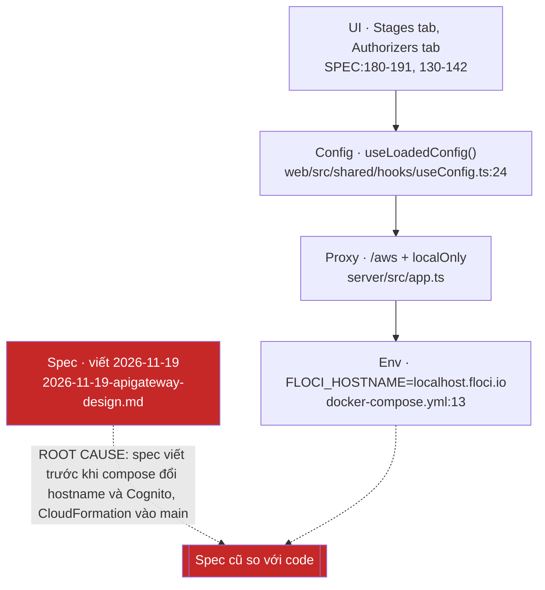
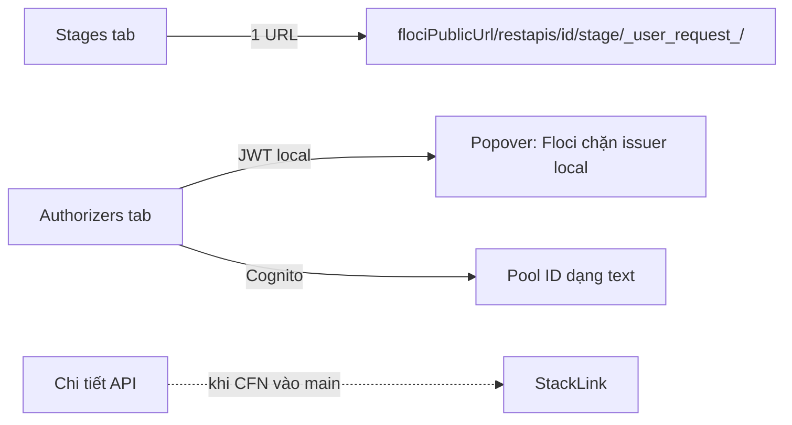
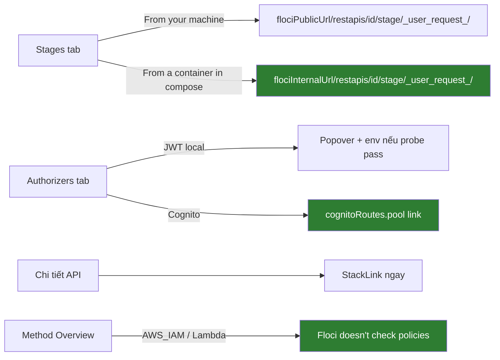

# API Gateway — Rà soát spec qua tranh luận 2 agent

> Ngày: 2026-11-24 · Trạng thái: Big Boss chọn C (2026-11-24), đã áp dụng vào spec + chạy thử (spec 7 #14–#17) · Rà soát cho: [apigateway-design](2026-11-19-apigateway-design.md) (đã duyệt 2026-11-19)
>
> Cách làm: agent RESEARCHER (nghiên cứu web: floci.io, GitHub releases Floci) và agent DOCS-KEEPER (chỉ đọc `docs/` + code) lập luận độc lập, rồi phản biện chéo 1 vòng. Không ai chạy Floci, không sửa file. Mọi "đã chạy" lấy từ khảo sát 2026-11-19 trên Floci 2.4.0.

## 0. Kết quả tranh luận

| # | Điểm | RESEARCHER | DOCS-KEEPER | Kết luận |
|---|---|---|---|---|
| 1 | Nguồn sự thật: docs floci.io hay chạy thật 2.4.0 | Nhượng: chạy thật thắng (docs là 2.5.x) | Giữ | **Chạy thật trên 2.4.0 thắng** |
| 2 | Bump Floci 2.5.0 | Không bắt buộc, task riêng | Ngoài phạm vi (chạm 22 spec, Traps, test, message trong code) | **Giữ 2.4.0**; bump = task riêng, kèm khảo sát lại |
| 3 | Stage variables, deployment history | Nhượng: cắt | Giữ cắt (SPEC:42) | **Cắt** (Floci không snapshot, dễ gây hiểu sai) |
| 4 | Invoke URL | Path form chính + host form phụ | Path form chính + dòng "From a container in compose" | **Path form, 2 dòng** (máy dev / compose). Host form chỉ thêm khi probe xác nhận |
| 5 | WebSocket URL | Nhượng: path form 403 trên 2.4.0 | Giữ dạng `.localhost:4566` | **Giữ SPEC:190** |
| 6 | JWT authorizer v2 + Cognito local | Có thể chỉ cần 1 env (vì `FLOCI_HOSTNAME` đã đổi) | Nhượng thành popover nếu chỉ cần 1 env | **Probe trước**; pass → thêm env mặc định tắt + popover; fail → chỉ popover |
| 7 | Lambda policy không bị Floci kiểm | Ghi chú trên UI | Nhượng: 1 dòng mô tả theo pattern có sẵn | **Thêm 1 dòng "Floci doesn't check…"** |
| 8 | Bảng liên kết service (CLAUDE.md bắt buộc) | Thiếu | Thiếu | **Thêm vào spec** (mục 3 dưới) |
| 9 | Test qua server-side fetch | Đề xuất | Giữ: `/aws` path form đã chạy, không sửa server | **Không sửa server** |

## 1. Waterfall — từ màn hình tới nguyên nhân

Không có bug trong code (chưa có code API Gateway). Lệch nằm ở spec.

## 2. Flow — hiện tại vs đề xuất

AS-IS (theo spec):

TO-BE:

## 3. Impact — sửa spec

| Mục spec | File | Từ | Thành | Blast radius |
|---|---|---|---|---|
| 2 Phạm vi | `2026-11-19-apigateway-design.md:20-55` | Không có bảng liên kết service | Thêm bảng dưới | Chỉ doc |
| 3.5 Authorizers | `:140` | Pool ID text "khi Cognito vào main" | Link `cognitoRoutes.pool` (`resourceLinks.ts:51`) | 1 component |
| 3.8 Stages | `:189` | 1 Invoke URL | 2 dòng, pattern SNS (`sns/components/DetailsTab.tsx:43-55`), dùng `flociInternalUrl` (`useConfig.ts:10`) | 1 component |
| 3.8 Stages | `:189` | Scheme theo `flociPublicUrl` | Ghi rõ: `FLOCI_TLS_ENABLED=true` → kiểm URL `https` | Chỉ doc + probe |
| 2 Không làm / 9 Quyết định | `:54, :291, :326` | "Đổi `FLOCI_HOSTNAME` đổi mọi URL" | Lý do cũ đã mất; quyết định theo kết quả probe JWT | compose (có thể 1 env) |
| 3.9 Lambda Triggers | `:205` | "như Kinesis" | Thêm `apigateway` vào `DISPLAY_ONLY_SOURCES` + `VIEW_ONLY_SOURCES` (`lambda/constants.ts:92-108`); `GetPolicy` chỉ khi mở tab Triggers | 3 file Lambda |
| 3.3 Method | `:112` | Không ghi chú | 1 dòng "Floci doesn't check function policies / IAM policies" | 1 component |
| 6 Kỹ thuật | `:263` | "một dòng trong registry", "khi CFN vào main" | Bỏ điều kiện; thêm `lazyPage` | `registry.ts`, `resourceLinks.ts:35-57` |
| 8 Thứ tự | `:305-312` | Bước 6 chờ CFN | Làm StackLink + resourceLinks cùng bước 4 | Chỉ doc |
| Traps | `docs/development.md` | — | "API Gateway: hành vi theo 2.4.0; 2.5.0 đổi quota, subtype SQS, phân trang GetApis — chưa kiểm" | Chỉ doc |

Bảng liên kết service (thêm vào spec):

| Service | Kiểu | Floci 2.4.0 | Console |
|---|---|---|---|
| Lambda | Integration proxy / non-proxy, authorizer TOKEN / REQUEST | Chạy; không kiểm policy | Link function, Triggers qua `GetPolicy` |
| Cognito | v1 authorizer; v2 JWT | v1 chạy; v2 issuer local bị chặn | Link pool (mới làm được) |
| CloudFormation | Stack tạo API | Chạy | `StackLink` + `resourceLinks` |
| SQS, SNS, DynamoDB, Step Functions, EventBridge | v1 `AWS` integration | Chạy (template đúng dạng) | URI nguyên văn, không link |
| S3 | v1 `AWS` integration | **Không chạy** | URI nguyên văn; Test ra 500 |
| SQS / Kinesis qua v2 `IntegrationSubtype` | v2 | **Không chạy** (2.5.0 mới có SQS) | Type + URI nguyên văn |
| CloudWatch Logs | Access / execution log | **Không ghi** | Chỉ link log Lambda |
| VPC link, CloudFront origin | Private integration, CDN | Có từ 2.4.0 (release notes), chưa kiểm | Không làm |

## 4. Options

| # | Option | Diff size | Pros | Cons | Failure mode |
|---|---|---|---|---|---|
| A | Không sửa spec, code theo spec cũ | 0 | Nhanh | Bỏ lỡ link Cognito, StackLink; URL compose thiếu; lý do JWT sai | App trong compose dùng `localhost:4566` → `ECONNREFUSED` |
| B | Sửa spec theo mục 3, không probe | ~10 chỗ, 1 spec + Traps | Nhỏ, khớp code hiện tại | Quyết định JWT vẫn còn mở | Popover JWT ghi sai cách bật |
| C | B + 1 lần probe Floci (JWT 1 env, host form, TLS) trước khi chốt | B + 1 script khảo sát | Chốt dựa trên chạy thật, đúng quy trình roadmap bước 2 | Thêm ~1 lượt khảo sát | Probe tạo resource sót lại (dọn bằng `leftovers.mjs`) |
| D | C + bump 2.5.0 | Lớn: 22 spec, Traps, test | Có subtype SQS, quota thật | Kiểm lại mọi quirk đã ghi | Hành vi đổi làm vỡ test IT đang có |

Recommend: C — sửa spec đúng chỗ đã lệch và chốt JWT / host form bằng chạy thật, không mở rộng phạm vi.

## 5. Verification

- [ ] Probe JWT: CDK / SDK tạo HTTP API + JWT authorizer issuer Cognito local, chỉ bật `FLOCI_SECURITY_ALLOW_PRIVATE_JWT_TARGETS=true` → gọi có token 200, không token 401. Fail → giữ "Không làm", chỉ popover.
- [ ] Probe URL compose: từ container console, `curl ${flociInternalUrl}/restapis/{id}/{stage}/_user_request_/…` → 200. Fail → không hiện dòng thứ 2.
- [ ] Probe host form: `curl http://{id}.execute-api.localhost.floci.io:4566/{stage}/…` từ máy dev và container → 200 cả 2 mới được thêm.
- [ ] Probe TLS: `FLOCI_TLS_ENABLED=true` → URL trong Stages dùng đúng scheme.
- [ ] Spec mới có bảng liên kết service; mọi dòng "khi … vào main" đã bỏ.
- [ ] Sau khi code: IT `tests/it/apigateway.test.ts` (REST + HTTP → Lambda qua `/aws`), E2E luồng chính SPEC:314, Lambda › Triggers thấy nguồn API Gateway.

**Kết quả chạy thử 2026-11-24:** JWT 1 env → 401 (giữ Không làm, chỉ popover); path form trong compose → 200 (thêm dòng 2); host form trong compose → `Connection refused` (không hiện); TLS dual mode, `http` vẫn chạy.

**Chưa kiểm (trước chạy thử):** issuer thật của Cognito Floci dưới `localhost.floci.io`; wildcard `*.localhost.floci.io` trong network compose; phần cuối release notes 2.5.0.
